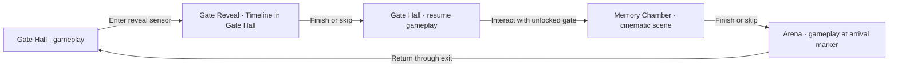

# Scene flow, cutscenes, and background loading

Proposed engine design, revised after a review of Unity, Unreal, and Godot.

**Recommendation.** Start with one active gameplay world, a reusable Timeline for cinematics, and explicit routes for
world changes. This fits indoor levels, distinct arenas, and story stages. Introduce additive regions when the game
needs to see or move across a boundary with both sides present. The first implementation milestone is the native timing
and memory baseline.

## What to adopt from other engines

| Evidence from existing engines                                                                                                                                                                                                                                                                                                                                                                                                                                                                                                                                                                                                                         | Decision for this engine                                                                                                                                                                                                     |
|--------------------------------------------------------------------------------------------------------------------------------------------------------------------------------------------------------------------------------------------------------------------------------------------------------------------------------------------------------------------------------------------------------------------------------------------------------------------------------------------------------------------------------------------------------------------------------------------------------------------------------------------------------|------------------------------------------------------------------------------------------------------------------------------------------------------------------------------------------------------------------------------|
| Unity moves asynchronous reads and deserialization off the main thread but still integrates objects there. Holding scene activation can stall its asynchronous operation queue. [Unity background loading priority](https://docs.unity3d.com/6000.0/Documentation/ScriptReference/Application-backgroundLoadingPriority.html) · [Unity scene activation](https://docs.unity3d.com/6000.0/Documentation/ScriptReference/AsyncOperation-allowSceneActivation.html)                                                                                                                                                                                       | Separate worker completion, native preparation, and activation. A prepared destination waiting for its trigger should release the worker for other requests.                                                                 |
| Unreal distinguishes loaded from activated regions, supports shaped and prioritized streaming sources, and budgets actor registration separately. Its volume guidance recommends standalone tests on the target platform. [Unreal World Partition](https://dev.epicgames.com/documentation/en-us/unreal-engine/world-partition-in-unreal-engine) · [Unreal streaming settings](https://dev.epicgames.com/documentation/en-us/unreal-engine/streaming-settings-of-the-unreal-engine-project-settings) · [Unreal streaming volumes](https://dev.epicgames.com/documentation/unreal-engine/level-streaming-volumes-reference-in-unreal-engine?lang=en-US) | Borrow shaped approach volumes, a release threshold, and an integration budget. Build replacement routes first. Treat additive regions as a separate feature with explicit render, physics, navigation, and audio lifetimes. |
| Godot exposes threaded resource status, can block if a result is retrieved before it is ready, and defers installation of the replacement scene to the frame boundary. [Godot background loading](https://docs.godotengine.org/en/stable/tutorials/io/background_loading.html) · [Godot scene changes](https://docs.godotengine.org/en/stable/classes/class_scenetree.html#class-scenetree-method-change-scene-to-node)                                                                                                                                                                                                                                | Poll readiness during gameplay. Let the current world own input and rendering until the candidate is valid. If a synchronous final pass is needed, show a loading frame before it starts.                                    |
| Unity Timeline binds reusable assets to scene-local objects. Unreal Sequencer documents blending into gameplay and explicitly choosing what to restore after a shot. [Unity Timeline assets and instances](https://docs.unity3d.com/Packages/com.unity.timeline@1.8/manual/tl-overview.html) · [Unreal cinematic handoff](https://dev.epicgames.com/documentation/unreal-engine/blend-gameplay-animation-to-cinematic-animation-in-unreal-engine)                                                                                                                                                                                                      | Store tracks separately from scene bindings. Give the sequence explicit, temporary ownership and a defined return to gameplay. Keep story outcomes in typed game actions.                                                    |
| Unity Addressables documents churn when the last reference is released and the same asset is requested again soon afterward. [Unity Addressables asset memory](https://docs.unity.cn/Packages/com.unity.addressables@2.7/manual/memory-assets.html)                                                                                                                                                                                                                                                                                                                                                                                                    | Measure representative returns before retaining idle assets. Keep active and preparing resources charged through ordinary ownership. Compare targeted prefetch, decode reuse, and GPU retention as separate experiments.     |

## What to put in a scene

| What you are making                                                  | Where to put it                                                      | What happens while it plays                                                                                                        |
|----------------------------------------------------------------------|----------------------------------------------------------------------|------------------------------------------------------------------------------------------------------------------------------------|
| A playable level, room with its own rules, or boss arena             | A registered scene with a stable scene ID                            | The scene owns its actors, colliders, triggers, cameras, and local simulation.                                                     |
| Walking, attacks, and other reactive actor movements                 | Reusable animation clips and the actor's Animator graph              | The Animator selects clips based on gameplay state.                                                                                |
| A camera zoom, a gate reveal, or a conversation in the current level | A Timeline sequence bound to actors and Camera objects in that scene | A director owns the shot and named actor channels until it returns control. The same live world stays in place.                    |
| A flashback or cinematic in a different environment                  | A separate registered scene with a Timeline sequence                 | A route prepares and activates the cinematic scene. The sequence ends by following a route to an explicit scene and arrival point. |

A cut is a camera change within a sequence. Put several cuts on the same Timeline when they use the same environment. A
cinematic scene is useful when the location, cast, or lighting needs its own authored world. Several scenes can
reference the same knight GLB and compatible imported skeletal clips. Existing scene-owned clips stay scoped to their
owning scene. Linked props can share eligible prop-owned clips. Each scene owns its own knight entity and runtime
state. [Authored clip binding rules](../crates/engine-core/src/animation/authored_clip/resolve.rs)

The example route starts and ends with playable scenes.



The Gate Reveal plays without a world swap. The gate can start preloading Memory Chamber while the player approaches.
When the memory sequence starts, its known completion route can begin preloading Arena. Finishing or skipping the
sequence uses the same route. A failure before activation leaves the outgoing world available.

## What the engine already provides

- `ProjectData` and `SceneCatalog` register scenes by ID and select the startup scene. Fixed-step sensor events and
  `SimulationAction::RequestScene` feed a `GameSession` that prepares a destination and validates its owner and
  generation at commit. The current pending request needs explicit retry and cancellation handling for an asynchronous
  flow. [Project schema](../crates/engine-core/src/project.rs) · [Trigger events](../crates/engine-core/src/triggers.rs) · [Game session](../crates/engine-core/src/game_session.rs)
- Cinder Oath demonstrates a scripted intro in its own scene, then a swap into the Arena. The installed Player's opt-in
  prefetch is specific to that pair and prepares parsed scene JSON. The Editor's authored-scene warming also has bounded
  preparation for references and eligible static model
  data. [Cinder intro implementation](../crates/cinder-oath-gameplay/src/duel.rs) · [Player prefetch](../apps/game/src/scene_prefetch.rs) · [Runtime worker](../crates/runtime/src/scene_prefetch.rs) · [Editor scene warming](../apps/editor-host/src-tauri/src/editor/scene_warming.rs)
- The Player can prepare a candidate while retaining the active scene's GPU resources. Static references share one asset
  catalog read per native scene assembly. Models needed by both scenes can reuse the same GPU allocations, and pruning
  after the swap releases models whose last owner is
  gone. [Player swap](../apps/game/src/play.rs) · [Native scene assembly](../crates/runtime/src/scene_io/native.rs) · [Asset manager](../crates/runtime/src/assets/asset_manager.rs)
- The animation authoring system has clips, an Animator graph, and marker cues. A scene-wide sequence that owns several
  actors, camera cuts, and playback completion is the proposed
  addition. [Authored clip timeline](../crates/engine-core/src/animation/authored_clip/timeline.rs) · [Animator runtime](../crates/engine-core/src/animation/animator_runtime.rs)

## Scene graph

Call the editor view **Scene Flow**. Show registered scenes as nodes and routes as arrows. Show an in-scene sequence on
its scene node and link to its Timeline. Keep the object hierarchy inside the Scene view. Start with a list of routes
and a route inspector, then add the canvas once routes can be authored and tested.

Give authors two actions. **Play Sequence Here** belongs to the local trigger and points to a sequence instance in the
current scene. **Go To Scene** belongs to a route and names the destination and arrival marker. Both can use a sensor or
typed signal. Only Go To Scene requires the world loader. This keeps a basic reveal within a single scene file and gives
the author a clear choice at the trigger.

A route has a stable ID, source and destination scene IDs, an activation rule, an optional typed condition, a preload
rule, and a named arrival marker. Pick sensors and arrival markers from the corresponding scene. Start with sensor
enter, interact while inside a sensor, and sequence completion. Resolve authored conditions and signals through
descriptors validated by the selected game module. For example, offer `gate-unlocked` in the editor if the module
registers it as a flag. Refer to content by project-local IDs and scene-qualified entity keys. Retain an optional, empty
route list for old projects.

The proposed route format keeps preparation and activation settings together.

```json
{
  "id": "gate-to-memory",
  "from": "gate-hall",
  "to": "memory-chamber",
  "activate": { "kind": "interact_in_sensor", "sensor": "gate-exit" },
  "condition": { "kind": "gameplay_flag", "key": "gate-unlocked" },
  "preload": { "kind": "approach", "distance": 12, "release_distance": 16 },
  "arrival": "memory-start",
  "start_sequence": "memory-reveal"
}
```

Validate the route catalog on save and export. Verify source and destination scenes, sensor components, arrival and
camera/actor bindings, sequence files and their dependencies. Share validation across Editor Play, Player, and export.
Allow return routes and other intentional cycles that require a new player action. Reject immediate automatic cycles.
When several routes match one committed step, use explicit priority. Flag known conflicts in preflight. If equally
ranked eligible routes still conflict at runtime, report the competing route IDs and keep the player in the source
scene. Match sequence completions to the source scene, sequence instance, and run so a replayed or cancelled cue cannot
trigger a second transition. Keep gameplay conditions, story state, and progression under the game module. The graph
describes permitted connections and when to request
them. [Scene catalog](../crates/engine-core/src/scene_catalog.rs) · [Project preflight](../compiler/src/preflight.rs) · [Simulation actions](../crates/engine-core/src/simulation_session/gameplay.rs)

## When background loading starts

Use separate rules for **prepare** and **activate**. An outer distance or volume asks for preparation. An inner sensor,
interaction, objective signal, or completed sequence asks for activation. Walking near a closed gate can prepare content
if its preload condition allows it. It cannot move the player through the gate. Check the route's gameplay condition
again immediately before committing.

- Measure the shortest distance from the possessed actor to the approach sensor in world units. In corridors or mazes,
  an authored approach volume is usually a better fit because straight-line distance can cross walls. Use an explicit
  sequence start cue when the next route is already known. Cinematic camera cuts do not change which actor drives
  proximity.
- Size the lead from the fastest supported approach and the measured p95 from preload request to **native ready**,
  including queueing and integration that can run ahead. For example, at 6 m/s, a 1.5 s p95 and 3 m of margin suggest 12
  m. In the CPU-only first version, assembly still happens at the exit. A longer approach can give the CPU worker more
  time, while the load screen covers assembly. For teleport, menu travel, or a known cinematic exit, enqueue the
  destination directly and use the same readiness check. Use project world units or define a scale before exposing
  meters.
- Release a speculative request beyond a larger exit threshold and after a short grace period. For the example route,
  leave the 12 m prepare area and cross 16 m before releasing. Give confirmed activation priority over speculation. Cap
  the first implementation at one speculative destination and one transition attempt. A confirmed request can take over
  the worker and cancel obsolete speculation. Share an in-flight request for the same destination when its content
  identity matches. Discard stale results when a branch is abandoned, the player teleports, or a project/run is closed.
  A cancellation immediately makes the attempt ineligible to commit. Keep charging its buffers until the worker
  acknowledges cancellation and any submitted GPU work has finished. Keep the slot bounded while it drains.
- Start with bounded CPU I/O, parsing, and validation on the existing worker. It currently limits source JSON to 2 MiB
  and estimated retained parsed data to 8 MiB. Add eligible model decoding only after measuring it. A confirmed miss
  goes to the worker using the normal scene reader and its 32 MiB source limit. Preserve the smaller speculative budget
  and count prepared references and models separately. Poll readiness from the native host. Keep live colliders,
  scripts, audio, and published scene state out of speculative work. All GPU work stays on the native owner thread.
  Budget background work and native uploads separately to protect frame pacing.
- If the player reaches an eligible exit early, keep the source authoritative. Let a door hold the actor in a safe area,
  or hold the cinematic’s final shot briefly and fade to a loading overlay. Present the overlay before synchronous
  native assembly, since the native owner cannot draw it while assembly blocks. Where the host can keep drawing, show
  preparing, finishing, retry, and cancel states at the relevant stages. A timeout offers the authored way back or a
  retry. Restart Run and Stop Play invalidate the attempt.

The working identity should include the run, source scene generation, route or request, and destination document
revision or fingerprint. Validate asset identities and revisions when adopting prepared models. This lets a newer
request, scene edit, or restart discard a late result even if it targets the same scene
ID. [Runtime prefetch worker](../crates/runtime/src/scene_prefetch.rs) · [Prepared static models](../crates/runtime/src/assets/warm_model.rs) · [Epic's streaming volume and hysteresis guidance](https://dev.epicgames.com/documentation/unreal-engine/level-streaming-volumes-reference-in-unreal-engine?lang=en-US)

## How the swap works

1. The source scene owns gameplay and presentation while the target is read and checked. Once an activation is accepted,
   reserve the route and assign an attempt ID. Default an accepted door transition to a safe hold that freezes gameplay
   steps and retains pause, cancel, and UI controls during the asynchronous wait. Restore the prior pause and input
   state on pre-commit cancellation. Allow routes with an authored safe waiting area to keep the outgoing simulation
   running and revalidate the condition at commit.
2. Build a candidate simulation with its destination spawn, local possession, camera, audio mix, and GPU resources.
   Apply the declared handoff values, such as health, inventory, quest flags, and a named checkpoint. Create destination
   entities from their authored data or typed saved state. Wait for the assets required for collision, control, and the
   opening shot before calling the candidate native ready. Future optional, decorative assets can have later readiness
   rules.
3. Account for the active world, unique candidate allocations, staging buffers, and cancelled work still in flight.
   Reuse shared allocations. If the candidate and active world cannot coexist within bounds, release idle retained
   entries first. Report a typed budget failure and leave the source valid if there is still insufficient headroom. The
   existing AssetManager admits GPU resources incrementally, so it needs a transition-level reservation before
   speculative native uploads are enabled.
4. At a native frame boundary, recheck the request, source generation, readiness and entry bindings. Commit the
   candidate once. Transfer the declared progress and input/camera/audio ownership together. Reset capture and suppress
   held actions until release so a click or key press from the last scene cannot trigger a new action.
5. Record the first destination frame the renderer reports as presented and the first simulation tick that accepts
   destination input separately from commit. A cinematic may deliberately delay gameplay input. Retire the old scene's
   resources when its submitted work is safe. Keep shared assets alive through ordinary ownership. Before commit,
   cancellation or failure can discard the candidate and restore the source's waiting policy without advancing story
   state. A presentation failure after commit follows the renderer's recovery path and is recorded separately.

```text
Active A → CPU ready B → Native ready B → Commit B → First frame B
                 └─ before commit, failure or cancellation keeps A active
Old GPU ownership retires when its submitted work completes.
```

For a visit to a different cinematic location, the first version either continues to a new scene or returns to a named
entry with explicit persisted state. Use an in-scene Timeline when exact positions, AI, and physics must resume on the
same live world. If a later game needs to walk through an open doorway and see both sides, add a small additive region
with a shared coordinate system and explicit collision, navigation, lighting, and audio rules. If two large, disjoint
levels cannot fit at once and the game accepts a full loading break, consider a tiny transition world after a verified
checkpoint. That mode releases the outgoing world early and needs a recovery route. Keep both features behind evidence
from replacement
routes. [Unreal transition map example](https://dev.epicgames.com/documentation/en-us/unreal-engine/travelling-in-multiplayer-in-unreal-engine) [Prepared activation ADR](../history/adr/resolved/0004-state-lifetimes-and-prepared-activation.md) · [Native Player scene install](../apps/game/src/play.rs) · [Editor Play install](../apps/editor-host/src-tauri/src/viewport/windows/play.rs) · [Unity asynchronous scene loading](https://docs.unity3d.com/6000.0/Documentation/ScriptReference/SceneManagement.SceneManager.LoadSceneAsync.html)

## What a Timeline owns

A **sequence asset** stores camera, clip, audio, subtitle and cue tracks with typed role IDs. A **scene instance** binds
roles such as `knight` and `reveal-camera` to local entity keys and declares its activation, repeat policy, and
completion route. Validate the camera role, actor rig and clip compatibility before claiming input or camera ownership.
Release ownership if a required binding disappears during playback. Store cue times as bounded integer milliseconds,
matching authored clip units. Evaluate cue crossings deterministically on the project's fixed clock so changing its rate
does not silently change the authored duration.

Start with explicit cuts between existing Camera objects and allow one sequence to own the view at a time. Return to the
previous live camera when it is still valid, otherwise use the scene default. Add a short authored blend once
cut/restore works. Treat a camera move and a lens zoom as different controls. Plot shot ranges on the Timeline so
authors can spot missing cameras or conflicting overlaps. A fade for loading covers a world swap. A camera blend joins
two views in the same
world. [Cinemachine shot transitions](https://docs.unity3d.com/Packages/com.unity.cinemachine@3.1/manual/concept-timeline.html#cinemachine-camera-transitions)

Use an explicit Animator override for cinematic actor poses and restore the previous owner on release. Start with
visual-only clips, suppress gameplay marker side effects and root motion on overridden channels, and let a typed
gameplay action own lasting movement. Gate movement, look, and combat input at the semantic input boundary, including
native modules. Keep pause and skip available. Stage the first in-scene cutscene in a safe area, since gating the
player's input alone leaves nearby AI and physics running.

Normal completion and skip use one finalizer. Resolve the same continuation, release camera and actor channels, clear
sequence-exclusive audio or subtitles, and suppress held input when gameplay resumes. Apply declared story changes once
when resuming in place. For a continuation that swaps worlds, stage the story changes and apply them at scene commit.
Retry the same pending continuation after a failed load without replaying story actions or cues. A skip settles declared
final state without emitting skipped one-shot cues. Capture durable changes explicitly, such as a gate staying open.
Restore temporary poses, camera and audio by default. Opening a preview, scrubbing, and cancelling have distinct
behavior from completing the sequence. For the first release, save at defined checkpoints before or after playback. Stop
Play or a failed start releases ownership without running completion actions. Preview and scrubbing evaluate poses and
camera shots on temporary state. They do not grant items, advance quests, or activate a runtime
route. [Simulation actions](../crates/engine-core/src/simulation_session/gameplay.rs) · [Existing Animation Timeline editor](../apps/editor/src/app/modules/editor/workspace/animation/timeline.ts) · [Unity Timeline assets and instances](https://docs.unity3d.com/Packages/com.unity.timeline@1.8/manual/tl-overview.html) · [Unreal sequence completion](https://dev.epicgames.com/documentation/unreal-engine/what-happens-when-my-cinematic-ends-in-unreal-engine) · [Godot animation seek](https://docs.godotengine.org/en/stable/classes/class_animationplayer.html#class-animationplayer-method-seek)

## Milestones

### 233. Measure switching A → B → A before changing retention

Extend `GameApp::exercise_scene_loads` in `apps/game/src/play.rs` and report against `SceneLoadTiming` in
`crates/runtime/src/scene_load_timing.rs`. The existing `--smoke-scene-cycles 60` path yields 30 measured transitions in
each direction after warmups. It already renders each destination. Add a companion record keyed to the timing request ID
with the source and destination IDs, fixture/profile identifier, mode, transition reason, and snapshots of the resource
counters. Use the existing scripts as the baseline parser. The current `gpu_us` spans scene assembly and install. Add
separate aggregates for catalog/scene parsing, model and texture decode, upload submission and its waits, the old-scene
GPU drain, and install. The renderer waits on a fence in the upload path and the Player waits for idle during
replacement. Without those separate measurements, a stall could lead us to build a cache for the wrong bottleneck.
Native `first_present_us` ends when the app reports a successful presentation path. Use it as a consistent timing proxy
and verify visible frame pacing in a standalone window
separately. [Player install](../apps/game/src/play.rs) · [Vulkan upload](../crates/renderer/src/vulkan/upload.rs) · [Khronos wait-idle and fence sample](https://docs.vulkan.org/samples/latest/samples/performance/wait_idle/README.html)

Run standalone Release with matched build, fixture, GPU, frame extent, present mode and storage settings. Keep captures,
temporary files, and build output on D:.

```powershell
$player = 'D:\Builds\engine-metrics\fixture\game.exe'
$env:ENGINE_LOG_DIR = 'D:\Builds\engine-metrics\logs'
& $player --player --smoke-test --smoke-scene-cycles 60
```

| Fixture                                                                | What it isolates                                                                                                                                                                   |
|------------------------------------------------------------------------|------------------------------------------------------------------------------------------------------------------------------------------------------------------------------------|
| Two small scenes sharing the same managed mesh                         | Positive control. Both scenes reference the same project asset, which should share allocations through the switch.                                                                 |
| Two scenes with disjoint assets, including a large textured model in A | Cost to return to A after A's last owner has left. A separate comparison can isolate geometry size from texture size.                                                              |
| Cinder Oath Intro ↔ Arena                                              | Actual animated characters, audio and a playable two-scene route. For Intro → Arena, add `--smoke-prefetch-probe` in both arms and add `--scene-prefetch` only in the enabled arm. |

Capture fresh-process first loads separately from repeated switches inside one process. Record both directions
independently. Report median, p95, worst observed frame gap, number of frames above the target frame budget, sample
count and failures. Pair the immediate switch loop with a scripted route that includes realistic time spent in the
level. Immediate returns can overstate the value of retaining resources. Record at least 30 measured switches per
direction per run and repeat three matched Release runs per mode in alternating test order. Record the fixture checksum
and hardware. Call a fresh process application-cold and record OS file-cache conditions separately.

| When                                                                           | What to record                                                                                                                                                                                                                                    |
|--------------------------------------------------------------------------------|---------------------------------------------------------------------------------------------------------------------------------------------------------------------------------------------------------------------------------------------------|
| Start, while preparing, and at first destination presentation                  | Request-to-first-present and phase time, prefetch lead, hit/miss and fallback rate, outgoing frame gaps across the full preload interval, and peak overlapping bytes. Split trigger-to-commit and commit-to-first-present for the new async path. |
| Before the switch, while both scenes own resources, and after retirement/fence | CPU retained cache/batch bytes as separate counters or clearly labelled estimates, logical GPU model bytes and count, and renderer-tracked allocation bytes and counts.                                                                           |
| Process baseline, peak and settled after repeated cycles                       | Process private bytes and working set as separate OS measures. Sample outside the timed frame path.                                                                                                                                               |

Precise GPU allocation counts and bytes should stabilize when comparing the same settled active scene after each cycle.
GPU upload/install wall time, tracked resource bytes, and process memory answer different questions. Set
`ENGINE_METRICS=1` for every resource-tracked run. Check primary timings in matched runs with tracking disabled if
instrumentation changes frame time. Renderer counters do not cover all driver-owned allocations. Capture peak as well as
settled memory so preparing a candidate cannot hide its overlap cost.

**Decision gate.** Keep existing pruning unless the captures show repeatable costly reloads after eviction. If repeated
CPU decode dominates, prototype bounded decode reuse. If new uploads dominate, try a small recent-GPU-model pool. If
upload fence waits or the old-frame drain dominate across both cold and reused cases, investigate batching and
fence-scoped retirement first. Time-slice native integration where the data justifies it. In separate matched runs,
compare either experiment to current pruning and to CPU prefetch. Adopt a policy only if return-to-scene p95 improves
beyond measured baseline jitter and the minimum gain chosen for the game, active frames stay within the calibrated
budget, peak memory stays within an explicit platform budget, and repeated cycles and cancellation leave stable settled
counters. Calibrate those budgets from the baseline. Milestone 216 established CPU decode costs for several fixtures,
and its measurements do not include native first presentation.

Sources [Smoke loop](../apps/game/src/play.rs) · [Timing records](../crates/runtime/src/scene_load_timing.rs) · [Renderer counters](../crates/renderer/src/window_renderer.rs) · [Metrics setting](../crates/renderer/src/metrics.rs) · [Scene load report](../scripts/measure_scene_load.py) · [Prefetch comparison](../scripts/measure_scene_prefetch.py) · [Milestone 216 measurements](../history/reviews/milestone-216-derived-cache.md).

### 234. Author and validate routes in core

Add `crates/engine-core/src/project/scene_flow.rs` for bounded types and route validation, register the optional
extension in `project.rs`, and use `compiler/src/preflight.rs` to validate references once all scene documents are
available. Use stable IDs and clear errors that name the route and scene. Ship one gameplay route using a source sensor
and destination spawn. Verify old projects, unknown bindings, automatic loops, and reachable intentional return routes.

```rust
// Proposed core result after validating an accepted activation.
ResolvedRoute { id, from, to, arrival }
```

Sources [Project schema](../crates/engine-core/src/project.rs) · [Fixed-step sensors](../crates/engine-core/src/triggers.rs) · [Preflight](../compiler/src/preflight.rs).

### 235. Make scene requests cancellable and retryable

In `crates/engine-core/src/game_session.rs`, give a pending transition an attempt identity and explicit terminal result.
Wire the attempt through `apps/game/src/play.rs` and `apps/editor-host/src-tauri/src/viewport/windows/play.rs`. Commit
only under the current attempt and scene generation. Test stale completion, a failed and retried load, a cancelled load,
an overbudget candidate, and the same scene ID targeted from a restarted run. Verify that a failed attempt can release
the pending state while the source remains playable.

```text
Requested → Preparing CPU → Preparing native scene → Ready → Committed
Before commit, cancel or fail → reject publication → reclaim when safe
```

Sources [Game session](../crates/engine-core/src/game_session.rs) · [Player transition](../apps/game/src/play.rs) · [Editor transition](../apps/editor-host/src-tauri/src/viewport/windows/play.rs).

### 236. Start a bounded preload from distance or volume

Extend `crates/runtime/src/scene_prefetch.rs` for route-associated preparation and replace the Player's Cinder-specific
coordinator in `apps/game/src/scene_prefetch.rs` with generic scheduling. Drive it from committed actor positions and
typed route events. Reuse the existing confined loading and cancellation. On a confirmed miss, submit the ordinary
bounded scene read to the worker and poll its terminal state between frames. Initially use the existing native assembly
path once the CPU candidate is ready, after rendering any waiting overlay. Use 233 to decide if buffering native uploads
in bounded batches or retiring resources by frame fence would help. Verify a fast sprint, retreat and re-entry, nearby
invalid routes, a teleport, changed destination bytes, and an early activation while loading. Bind speculative
retirement to a larger distance and grace period than entry.

```text
Inside prepare area → request CPU preparation
Valid inner activation → claim it or wait for the bounded fallback
Outside release area long enough → cancel speculative work
```

Sources [Runtime prefetch](../crates/runtime/src/scene_prefetch.rs) · [Existing Player coordinator](../apps/game/src/scene_prefetch.rs) · [Normal scene reader](../crates/runtime/src/scene_io/document.rs) · [Epic streaming volumes](https://dev.epicgames.com/documentation/unreal-engine/level-streaming-volumes-reference-in-unreal-engine?lang=en-US).

### 237. Play a same-scene Timeline and return control

Add `crates/engine-core/src/sequence.rs` for the versioned sequence data and
`crates/engine-core/src/simulation_session/sequence.rs` for fixed-step playback. Start with a camera zoom, one actor
clip and an end cue. Test asset/instance binding and cancellation before adding camera blends. Pin the sequence's
content revision at start, retain only valid scene-generation bindings, and use a visual Animator override and the
shared gameplay input gate. Add typed audio and subtitle cues and compile/validate their references in
`compiler/src/dependencies.rs`. Verify that gameplay resumes at the same position in the safe fixture. Test skip at the
start and finish, simultaneous skip and completion, reuse with different bindings, deleted bindings, a change in
fixed-step rate, and pause/resume. Only natural completion and skip settle story state once. All interruption paths
release ownership and discard held gameplay actions. Reuse the existing Actor Animation Timeline UI patterns when adding
the sequence editor.

```text
0.0 s  switch to reveal camera and play the knight's turn
1.0 s  play gate sound and show subtitle
3.0 s  finish, clear temporary channels, and return gameplay input/camera
```

Sources [Animation Timeline](../crates/engine-core/src/animation/authored_clip/timeline.rs) · [Simulation actions](../crates/engine-core/src/simulation_session/gameplay.rs) · [Compiler dependencies](../compiler/src/dependencies.rs) · [Unity Timeline](https://docs.unity3d.com/Packages/com.unity.timeline@1.8/manual/tl-overview.html).

### 238. Play a cinematic scene between gameplay levels

Use the shared `GameSession` and host swap paths for Stage → Arena as well as ordinary level transitions. Add a
disposable three-scene fixture under `tests/fixtures/` for gameplay → cinematic → gameplay. Start the next preload at
sequence start and let the sequence's finish or skip release the authored route when ready. Verify declared progress
transfer, named arrival markers, failure with a playable source, and headless replay of the same route decisions.
Headless can supply readiness at recorded simulation steps so wall-clock worker timing cannot change replay results. Run
Editor Play and the standalone Player.

```text
Gate Hall → Memory Chamber (start sequence) → Arena (spawn at arena-entry)
```

Sources [Game session](../crates/engine-core/src/game_session.rs) · [Cinder example](../crates/cinder-oath-gameplay/src/duel.rs) · [Headless replay](../apps/headless/src/replay.rs).

### 239. Add Scene Flow and sequence authoring to the Editor

Add a proposed `apps/editor/src/app/modules/editor/workspace/scene-flow/` pane with scene list, route inspector, and
graph view. Reuse the typed bridge in `apps/editor/src/app/core/editor/editor.models.ts` and the native editor command
pipeline so editing a route supports undo and save. Provide sensor and spawn pickers, a preload volume overlay, and a
button to open the bound Timeline. Show source and destination references and explain which route condition prevented
activation. Offer Test Route in Play before adding the graph canvas. In Play, expose queued, CPU ready, preparing
graphics, native ready, failed, and committed. Add keyboard-accessible list interactions and a preview that never
changes authored scene objects or live play progress. Verify link creation, validation, undo, preview, and preference
continuity across project reopen.

```text
Gate to Memory → Activate on interact → Gate Exit → Memory Start
Preload at 12 m → Release beyond 16 m → Open Memory Reveal Timeline
```

Sources [Typed Editor contracts](../apps/editor/src/app/core/editor/editor.models.ts) · [Timeline editor](../apps/editor/src/app/modules/editor/workspace/animation/timeline.ts) · [Editor command pipeline ADR](../history/adr/0001-editor-command-pipeline.md).

### 240. Choose the retention policy from measured results

Use the gate from 233 and rerun the real route from 238. If the result justifies retention, implement the smallest
measured candidate in `crates/runtime/src/assets/asset_manager.rs` or its existing source-cache/budget modules. Use a
single discardable recent set bounded by bytes, age and resource count. Charge shared resources once. Active, preparing,
and not-yet-reclaimed in-flight resources count against the same admission budget as idle retained resources. Evict idle
entries first, invalidate on changed content, and never retain full worlds for this feature. Add an opt-in experiment
until latency, memory and frame pacing are captured on target hardware. If no candidate meets the gate, record the
outcome and keep pruning.

```text
Admit candidate → evict eligible idle entries if needed → enforce peak budget
```

Sources [Asset manager](../crates/runtime/src/assets/asset_manager.rs) · [CPU source cache](../crates/runtime/src/assets/asset_manager/source_cache.rs) · [GPU budget](../crates/runtime/src/assets/asset_manager/gpu_budget.rs) · [Native resource lifecycle test](../apps/game/tests/unit/tests_runtime_lifecycle.rs).

## Seamless open-world milestones

Start the additive prototype after the scene-loading baseline and cancellation behavior are verified. Use one persistent
gameplay world with several resident regions. Proceed with the existing asset policy if Milestone 240 finds no reason to
retain more meshes.

| Milestone                         | Deliverable                                                                                                                                                         |
|-----------------------------------|---------------------------------------------------------------------------------------------------------------------------------------------------------------------|
| 241. Define world regions         | Give regions stable IDs, bounds, and shared coordinates. Author a three-region test path with one owner for each seam collider.                                     |
| 242. Attach and detach regions    | Keep the same player, camera, and simulation. Add incoming geometry and collision before crossing, then retire the outgoing region when it is safe.                 |
| 243. Schedule region streaming    | Preload upcoming regions, retain neighbors when the player reverses, and prioritize destination readiness for fast travel. Test late loads and low-memory fallback. |
| 244. Preserve region state        | Restore opened doors, collected items, and other declared changes when a region reloads. Verify revisits and save/load.                                             |
| 245. Export a partitioned world   | Package region files and shared assets through the compiler. Verify the same crossing in the exported Player.                                                       |
| 246. Add an Editor streaming view | Display region bounds, loading status, and memory use. Give authors a way to test a boundary in Play.                                                               |
| 247. Verify a larger world        | Sprint, reverse, and travel across a branching map. Measure frame hitches and verify that memory and simulation work scale with resident regions.                   |

Use the larger-world capture and the game's needs to choose the following extensions.

| Milestone                              | Deliverable                                                                                                                              |
|----------------------------------------|------------------------------------------------------------------------------------------------------------------------------------------|
| 248. Reduce distant rendering cost     | Add simplified distant terrain and structures so the horizon remains visible within the rendering budget.                                |
| 249. Connect navigation across regions | Let NPCs path across loaded boundaries and handle routes whose next region is still loading.                                             |
| 250. Support larger coordinates        | Measure camera and collision precision. Adopt a local origin or higher-precision coordinates if the target map exceeds the tested range. |

Sources [Unreal World Partition](https://dev.epicgames.com/documentation/en-us/unreal-engine/world-partition-in-unreal-engine) · [Unity additive loading](https://docs.unity3d.com/6000.0/Documentation/ScriptReference/SceneManagement.LoadSceneMode.Additive.html) · [Native resource lifecycle test](../apps/game/tests/unit/tests_runtime_lifecycle.rs) · [Export preflight](../compiler/src/preflight.rs).
