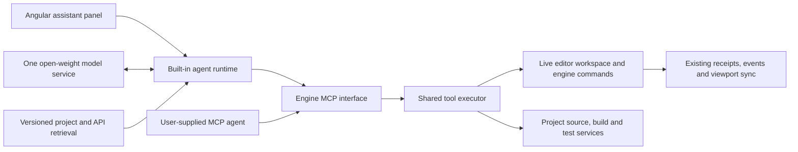

# ADR-0014: Project-aware open-weight assistant and MCP tools

- **Status:** Proposed
- **Date:** 2026-10-27
- **Scope:** One built-in open-weight model for development and editor operation, project knowledge and fine-tuning,
  and a shared MCP interface for user-supplied agents.

## Context

The engine needs an assistant that can implement development logic and work in the editor. Users must also be able
to connect their own MCP-compatible agent without using, downloading, or training the built-in model.

These are two capability profiles for one assistant. Development work changes project source and uses builds and
tests. Editor work inspects and changes the active authoring session. Both need the engine's actual contracts and
current project state. A model trained on an older repository cannot establish that an API, asset, or entity exists
in the current session.

The integration must preserve one authority for authored state and keep model inference outside Vulkan rendering,
fixed-step simulation, and synchronous editor command handling. Model training and serving are separate from ordinary
game execution. Autonomous in-game NPC reasoning is outside this proposal.

## Current implementation inspected

Inspected commit `279c03ff3b331f79a6cd6a8ecacb27894a3f6600`, Git history, and the staged, unstaged, and untracked tree
on 2026-10-27. Concurrent working-tree changes are inspected implementation in progress, not an accepted protocol.

| Existing code                                                 | Relevant behavior and boundary                                                                                                                                 |
|---------------------------------------------------------------|----------------------------------------------------------------------------------------------------------------------------------------------------------------|
| `crates/engine-core/src/command.rs`                           | Typed editor commands, expected revisions, snapshots, and command capability metadata. The capability list is not a complete set of LLM tool argument schemas. |
| `crates/engine-core/src/engine.rs`                            | Validates requests against the current revision and returns receipts and change cursors.                                                                       |
| `crates/engine-core/src/editor/mod.rs`                        | Backend-owned authored state, command validation, grouped edits, rollback, and undo/redo.                                                                      |
| `apps/editor-host/src-tauri/src/commands/editor.rs`           | Native commands require the trusted editor WebView; they are not an external agent endpoint.                                                                   |
| `apps/editor-host/src-tauri/src/editor.rs`                    | Owns the live workspace and coordinates editor operations, imports, saving, and build preparation.                                                             |
| `apps/editor/src/app/core/editor/editor.service.ts`           | Orders UI commands and synchronizes accepted state. Concurrent bridge/frontend changes add incremental updates.                                                |
| `crates/engine-core/src/simulation_session.rs`                | Native `GameModule`/`GameModuleFactory` planning uses read-only world data and bounded actions. This is not an arbitrary source loader or scripting runtime.   |
| `apps/headless/src/main.rs`                                   | Bounded CPU project/scene replay and state summaries can support future agent evaluations.                                                                     |
| `apps/admin-dashboard/src-tauri/src/jobs.rs` and `metrics.rs` | Existing build/test coordination and bounded resource-snapshot inspection are useful service inputs.                                                           |

The inspected tree has no implemented LLM orchestration service, engine MCP server, trained engine adapter, or
agent evaluation suite. Writing this ADR does not add them.

## Dependencies

Reuse the command ownership and build direction in [ADR-0001](0001-editor-command-pipeline.md), the transport and
versioning proposal in [ADR-0003](0003-rust-typescript-bridge.md), and the state separation in
[ADR-0004](0004-authoring-play-and-editor-state.md). Gameplay code must follow
[ADR-0008](0008-game-modules-and-scripting.md); generating source does not select a scripting runtime or establish
hot reload. Asset tools follow [ADR-0006](0006-asset-identity-and-import-pipeline.md), and saving/recovery follows
[ADR-0011](0011-persistence-autosave-and-recovery.md). Visual inspection follows
[ADR-0012](0012-native-viewport-composition.md).

These references preserve each ADR's own status. The assistant must not advertise their proposed features as
implemented capabilities.

## Proposed decision

### One model, two profiles, one tool contract

Target one selected open-weight base checkpoint with a versioned engine-specific adapter trained across both profiles.
A retrieval-only prototype establishes the baseline; it does not complete the trained-assistant goal. The profile
selects instructions, context, and granted tools; it does not require a separate model for each role.
The built-in agent and user-supplied agents use the same versioned MCP tools and backend validation.

| Profile     | Intended work                                                                                              | Illustrative tools, not existing endpoints                                                                                |
|-------------|------------------------------------------------------------------------------------------------------------|---------------------------------------------------------------------------------------------------------------------------|
| Development | Implement gameplay logic, inspect engine APIs, propose source changes, build and verify the project.       | `project.search`, `source.read`, `source.propose_patch`, `source.apply_patch`, `build.start`, `test.start`, `job.inspect` |
| Editor      | Inspect the active scene and assets, arrange entities, change supported properties, and verify the result. | `editor.inspect`, `assets.query`, `scene.apply_batch`, `history.undo`, `play.start`, `play.stop`, `viewport.capture`      |

For example, development work might implement a supported movement behavior and verify it with tests. Editor work
might arrange instances of an existing asset in a grid and undo that arrangement as one edit. Tools are advertised
only when their implementation, state requirements, and permission checks exist.

Keep normal scene editing, builds, and the player usable when no model service is running. A user connecting an
external agent supplies that agent's model and orchestration; MCP provides access to engine capabilities and project
context, not the built-in model's weights or hidden conversation state.

### Put MCP around shared native services

Extract a host application-service boundary that can be called by the existing Tauri adapter and an authenticated
agent adapter. Retain the trusted-window check on Tauri commands. An MCP caller must not impersonate a WebView,
evaluate JavaScript to reach native APIs, or construct a second independent `Engine` for the visible scene.

The editor host continues to own the live workspace. A local MCP bridge attaches to a specific workspace/session
over explicit native IPC. It reports unavailable or stale sessions rather than silently editing an offline copy.
The built-in agent is a client of this interface too, so external clients exercise the same supported operations.

Proposed component boundaries are:

- A Rust tool-contract/executor module for schemas, capability checks, operation receipts, and service adapters.
- An engine MCP adapter/bridge for discovery, resources, tools, and connection lifecycle.
- A separate agent runtime and inference worker for conversations, retrieval, tool-call handling, and cancellation.
- Offline training and evaluation tooling with versioned datasets and model artifacts.

These are responsibility boundaries; final crate and application names remain an implementation choice. The
[official Rust MCP SDK, `rmcp`](https://docs.rs/rmcp/latest/rmcp/), supplies server/client support, schema generation,
and stdio/Streamable HTTP transports. Pin and test the selected SDK and supported protocol revisions before shipping.

Start with a stdio bridge for local agent configurations. Reserve stdout for MCP messages and keep diagnostics on
stderr and existing session files. Add persistent HTTP connections when required; use the protocol's authentication
and Origin checks and bind local endpoints to loopback. Localhost alone is not an authorization decision.
[MCP transport specification](https://modelcontextprotocol.io/specification/2025-11-25/basic/transports).

Expose read-only resources for supported API/schema versions, project manifests, selected source/reference material,
asset metadata, and scene summaries. Fetch bounded context on demand. Tool discovery and schemas must come from the
implemented contract, not a second hand-maintained list inside a model prompt.

### Preserve revision, transaction, and project boundaries

An editor mutation identifies the workspace/session, expected revision, request ID, and bounded typed operation.
The executor resolves current entities/assets, validates permissions and arguments, and delegates to the same backend
commands used by the UI. It returns authoritative receipts, diagnostics, and change cursors so the existing UI and
viewport synchronize normally. Repeated request IDs require bounded deduplication/recovery semantics; a lost response
must not blindly create the same entities again.

Generate a plan asynchronously, then validate and apply a bounded batch under one short backend transaction. Roll
back the whole batch on a rejected operation. Never leave an editor transaction or mutex held while waiting for a
model, network response, build, or approval. Stale revisions require fresh context and replanning. Multiple agents
and manual edits share this authority and ordering policy.

Development tools operate inside the selected project and an isolated, reviewable change workspace. Source changes
produce patches and explicit build/test results. Tool arguments select supported jobs and profiles; the initial tool
surface does not accept arbitrary terminal command strings. Applying changes to the user's active working tree follows
the configured project grant and must preserve concurrent edits.

Use scoped grants for inspection, scene mutation, source changes, and build execution. A granted workflow can proceed
without repeated confirmation for each tool call. Extending its scope requires a new grant. Model output, retrieved
files, imported assets, and logs cannot grant permissions. Saving, installing, publishing, and source application
remain explicit operations under the relevant contracts.

Generated Rust logic must pass through a supported module/build path. The current native module trait is a useful
boundary, but source generation alone does not install code into a running editor. Build and restart/reload are explicit
until ADR-0008's runtime and reload contracts are implemented and verified.

### Combine current project knowledge with focused training

Use retrieval for changing facts: source, public API contracts, tests, supported examples, documentation, asset
metadata, and current editor state. Record project revision/content digests and engine/tool-schema versions with each
context bundle. Treat documentation as reference material whose freshness must be checked against source and tests.
Exclude generated caches, secrets, unrelated projects, and unapproved user content from indexing and training.

Fine-tune the selected base model with LoRA/QLoRA on verified workflows for both profiles. Training examples contain
the user task, relevant versioned context, available tool schemas, tool calls, actual results, recovery steps, and a
verified outcome. Include rejected commands, stale-state recovery, cancellation, undo, and failed builds as well as
successful edits. A repository file dump is not sufficient evidence of reliable tool use.

[TRL's SFT trainer](https://huggingface.co/docs/trl/en/sft_trainer#tool-calling-with-sft) supports datasets containing
tool calls, tool responses, and tool JSON
schemas. [PEFT's quantization guidance](https://huggingface.co/docs/peft/developer_guides/quantization)
describes LoRA training over quantized weights, including QLoRA. These are candidate training mechanisms, not proof
that a selected checkpoint, quantization, or training recipe works on the development machine.

Collect traces only under an explicit data policy, with provenance and redistribution rights recorded. Redact
credentials and sensitive project content before durable logging or dataset inclusion. Keep ordinary telemetry
separate from opted-in training data. Hold out tasks and projects from training, and compare base-plus-retrieval
against the tuned model before promoting an adapter.

Publish a model manifest with base checkpoint/revision, adapter, tokenizer/chat template, tool parser, supported
engine/schema versions, quantization, dataset provenance, evaluation results, and measured hardware requirements.
Refresh retrieval when a project changes; update adapters when measured workflow failures justify retraining.

### Select and serve the model after measurement

An initial local prototype candidate is [Qwen3.5-9B](https://huggingface.co/Qwen/Qwen3.5-9B), whose publisher provides
open weights and tool-calling integration. A coding-oriented server candidate is
[Qwen3-Coder-Next](https://huggingface.co/Qwen/Qwen3-Coder-Next). These are evaluation candidates, not an accepted
production checkpoint or a promise of Rust/game-development quality.

Qwen3-Coder-Next has 80B total parameters with 3B active per token. Active parameters describe computation and must
not be used as the total weight-memory budget: raw 4-bit storage for 80B parameters is approximately 40 GB before
runtime overhead. Partial CPU offload changes deployment and latency rather than making it a 3B-sized model.

Choose one checkpoint for both profiles after representative tasks and hardware tests. Quantization, context length,
KV cache, inference buffers, and the running editor's GPU allocation all affect feasibility. Local inference competes
with Vulkan for device resources; a separate inference server is an alternative when that contention is unacceptable.
Training may use different hardware from deployment. Do not perform training in the renderer or simulation process.

Serve inference behind a replaceable model-service interface with streaming, timeouts, cancellation, bounded context
and output, and request/tool-call budgets. A model failure leaves the scene and project in the last accepted state.
The editor waits on an asynchronous job, never on an inference call in the frame or fixed-step loop.

Record model latency, tool outcomes, retries, resource use, and accepted/rejected edits through shared diagnostics.
Inference allocations need their own accounting: the existing Vulkan metrics track instrumented engine-owned Vulkan
allocations and do not measure a separate inference worker's CUDA or other allocations.

## Alternatives and consequences

| Alternative                                           | Tradeoff                                                                                                               |
|-------------------------------------------------------|------------------------------------------------------------------------------------------------------------------------|
| Train a model from scratch                            | Requires a separate foundation-model effort; does not provide current session knowledge or engine integration.         |
| Fine-tune on source alone                             | Can adapt terminology but does not establish correct tools, current APIs, or successful end-to-end workflows.          |
| Retrieval without fine-tuning                         | Useful initial baseline and may be sufficient for some tasks; measure before adding an adapter.                        |
| Separate coding and editor models                     | Allows specialization but adds deployment, training, and compatibility costs; defer while evaluating one shared model. |
| Separate private tools for the built-in agent         | Allows quick prototypes but duplicates contracts and leaves user-supplied agents with a weaker path.                   |
| General desktop clicking as the main editor interface | Can help unsupported workflows, but provides weaker state/version guarantees than typed native tools.                  |
| Model inference inside engine-core                    | Couples variable-latency inference and its dependencies to deterministic engine execution; reject.                     |

The proposed approach adds an MCP/service boundary, inference lifecycle, retrieval index, training artifacts, and an
evaluation maintenance burden. It reuses engine validation and makes model choice independent of user agent choice.
No amount of fine-tuning replaces schema, authorization, state, or outcome validation.

## Implementation sequence and acceptance

1. **Establish the tool contract and live-session adapter.** Start with inspection and a small editor mutation set.
   Verify schema failures, unsupported capabilities, session identity, revision conflicts, batch rollback, one-step
   undo, replay/deduplication, and synchronization with manual editor changes. Preserve Tauri's existing trust boundary.
2. **Prove external MCP access first.** Connect an independent client through stdio; prove discovery, structured
   results, bounded resources, cancellation, clean stdout, reconnect behavior, and project/grant isolation. Test HTTP
   authentication and Origin handling before enabling that transport. Prove no duplicate invisible editor state exists.
3. **Add development tools and the built-in agent.** Demonstrate a source patch that compiles and passes declared tests,
   plus a supported scene-edit workflow with verified state and undo. Build/test jobs return IDs, progress and bounded
   results. Verify a disabled/offline model does not break ordinary editor, player, or headless operation.
4. **Evaluate retrieval and model candidates.** Use held-out development and editor tasks, invalid tool calls, stale
   context, interrupted edits, and build failures. Measure task completion, behavioral correctness, recovery, tool-call
   validity, latency, memory, and editor frame-time impact on declared hardware. Headless replay does not establish GPU
   rendering or visual correctness; native acceptance remains separate.
5. **Train and gate one engine adapter.** Curate approved successful and failure/recovery traces, train the selected
   LoRA/QLoRA adapter, and compare it against the retrieval baseline on held-out tasks. Version the manifest and
   contract;
   promote only after the recorded quality and resource gates pass. Keep a tested fallback to the previous artifact.

Before accepting implementation, choose the supported game-code authoring path, model checkpoint and serving runtime,
client/protocol compatibility range, dataset policy, project grants, and numerical budgets. Exact quality thresholds,
training hardware, inference concurrency, and production model selection remain open.

This ADR records the proposed architecture and inspected foundations. No engine MCP server, model download, inference
benchmark, fine-tuning run, trained adapter, or external-agent acceptance test was performed by writing it.
