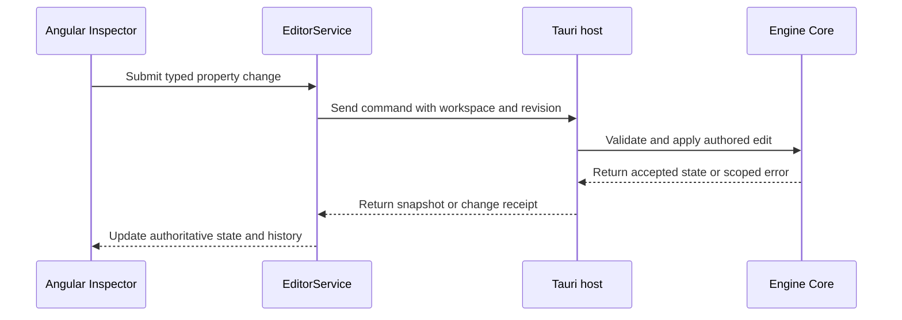
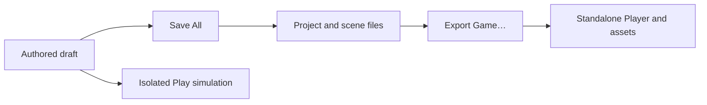

# Editor command flow

Follow a Hierarchy or Inspector edit from the Angular control through the native workspace. Save persists the
resulting authored draft. Play starts a separate simulation, and Export Game… packages the saved project.

## Open a workspace

1. Start the [Windows Editor](windows-editor-quickstart.md). Use **File → Open Project…** to select a project
   manifest, or **New Project…** to create a fresh directory and its initial scene.
2. The native host validates the project location and prepares a candidate scene, assets and viewport.
   It keeps the current workspace until the candidate is ready. An accepted Open establishes a new workspace
   generation. Scoped controls from the previous workspace can then discard their pending state.
3. Angular reads the native capabilities and authoritative snapshot through `EditorService`. The editor workspace
   renders the scene catalog, Hierarchy, Inspector and native viewport host from that state.

## Follow an Inspector edit

Use the Angular editor transport for commands and the scene-editing service for selection-sensitive edits. The
native host checks the window, workspace generation and expected revision. The Engine Core session validates the
change and records authored patches for Undo. It can group related mutations into a single transaction.

Treat the workspace generation, command revision and render scene revision as distinct values. Generation
changes when the workspace is replaced. Authored command revision governs consistency. Render scene revision
invalidates the displayed projection, including changes produced during Play. See [command ownership](scene-editing.md)
and [bridge contracts](crates/bridge/README.md).

## Save, enter Play and export

- **Save All** validates and writes the manifest and changed scenes. File errors surface against the active project.
  See [save and reload](project-lifecycle.md#save-save-as-register-and-reload).
- **Play** opens an isolated simulation from the active authored draft. The command host routes native focus and
  input according to the current Scene or Game view. **Stop** leaves the authored draft available.
- **Export Game…** checks the saved project and stages its assets. The compiler prepares the executable and writes
  the standalone folder. The packaged Editor uses its bundled Player. See [compiler packaging](compiler/README.md).

## Find the source

| Responsibility | Entry point |
| --- | --- |
| Angular command queue and snapshots | `apps/editor/src/app/core/editor/editor.service.ts` |
| Desktop command registration | `apps/editor-host/src-tauri/src/lib.rs` |
| Native project and build commands | `apps/editor-host/src-tauri/src/commands/editor/` |
| Authoring commands and history | `crates/engine-core/src/editor/` |
| Shared simulation | `crates/engine-core/src/simulation_session.rs` |
| Player packaging | `compiler/src/lib.rs` |

Use [testing and validation](testing.md) to choose checks at the appropriate layer.
