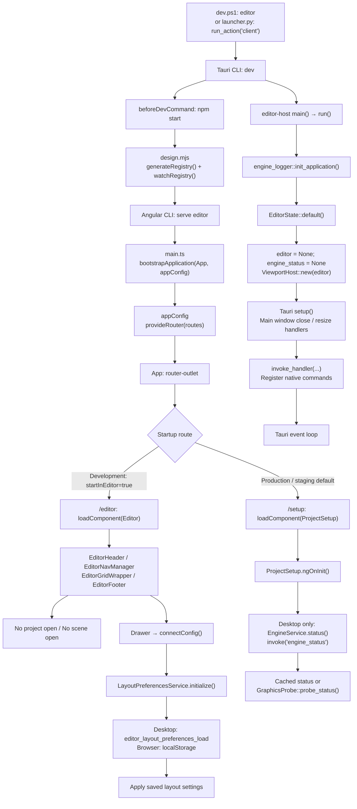
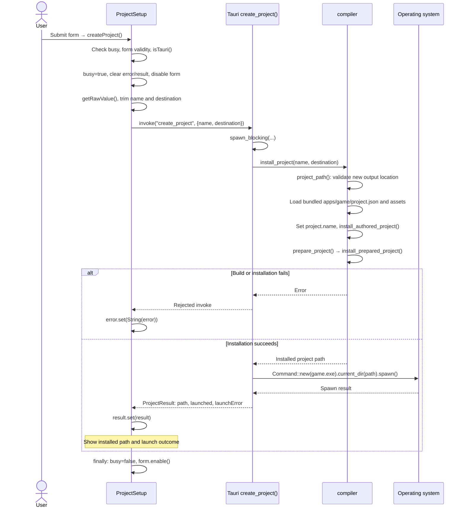
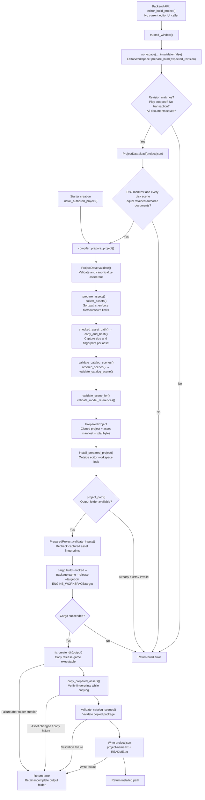
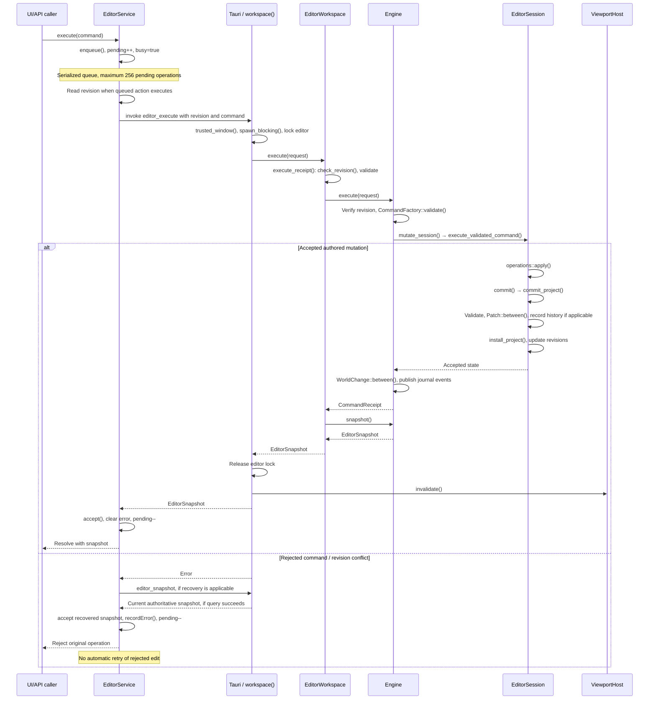
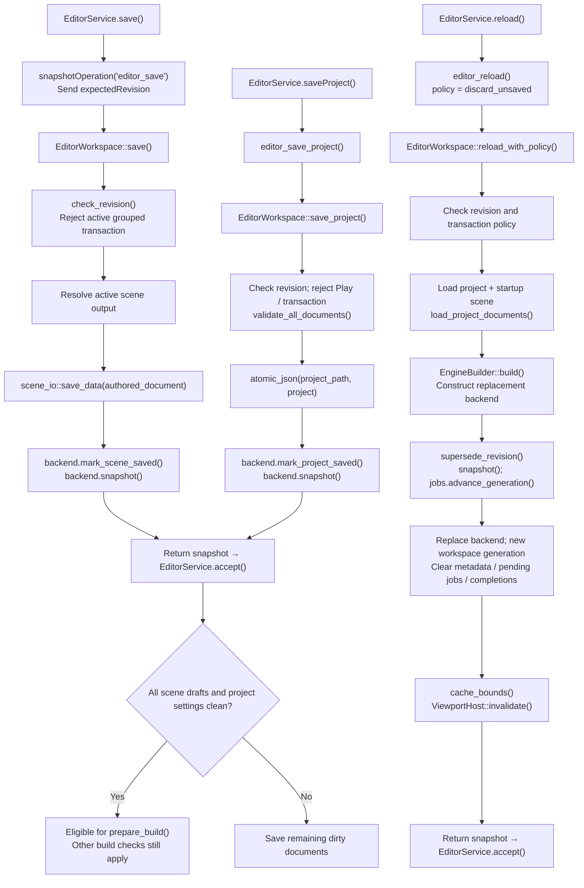
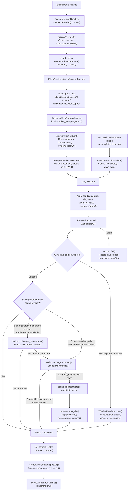
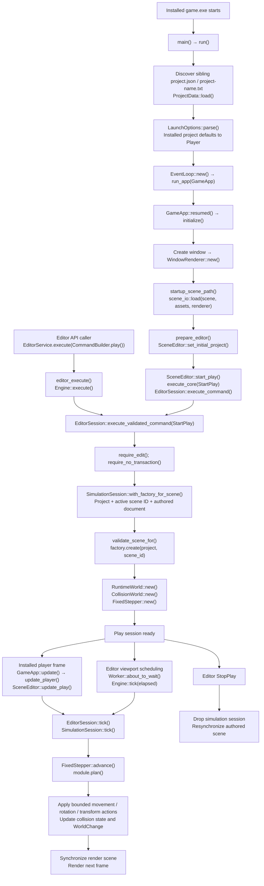
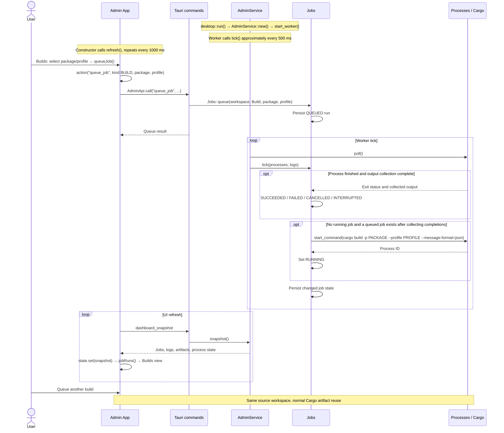
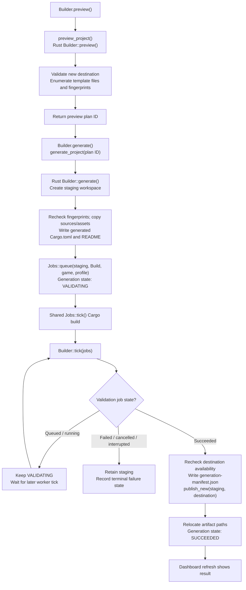

# Editor flow: startup to project builds

Trace the current method calls from desktop startup through project creation, editor state, native rendering,
simulation, packaging, and repeated builds in the admin UI. The diagrams distinguish working UI actions from APIs
that exist without a caller in the main editor screen.

Source inspection: **2026-10-27**, commit `fcb748b04853209b5e17e680c38c847c19f7f365` plus the working tree, including
the uncommitted explicit-scene simulation changes. This is an implementation trace, not a proposed architecture or
native runtime acceptance result. See [project lifecycle](project-lifecycle.md) for document contracts and
[the ADR reading guide](adr/README.md) for proposed changes.

## What is connected today

| Surface or operation           | Current entry point                           | Result and boundary                                                                                                                        |
|--------------------------------|-----------------------------------------------|--------------------------------------------------------------------------------------------------------------------------------------------|
| Setup: Create & launch project | `ProjectSetup.createProject()`                | Packages the bundled starter into a new folder, then attempts to launch its player.                                                        |
| Main `/editor` route           | `Editor` and its layout components            | Displays the editor shell and empty-project/scene state. No Open, Save, Play, Build, or Rebuild control currently calls the document APIs. |
| Open/edit/save/reload APIs     | `EditorService` and registered Tauri commands | Implemented integration surface; requires a UI owner to invoke it and consume the signals.                                                 |
| Authored project package       | Native `editor_build_project()`               | Requires clean saved authoring state; compiles and installs into a new folder. No current `EditorService` wrapper or main editor control.  |
| Native game pane               | `EnginePortal` / `EngineViewportDirective`    | Present in the design preview; not mounted by the main `/editor` route.                                                                    |
| Admin Builds                   | `App.queueJob()`                              | Queues repeatable Cargo builds of packages in a source workspace.                                                                          |
| Admin Builder                  | `Builder.preview()` / `generate()`            | Creates and validates a new standalone source workspace.                                                                                   |

The main layout's `EditorPortal` is a content wrapper, not the native `EnginePortal`. The shared
`shared/builder/builder.service.ts` is empty at this inspection. A native command being registered does not mean a
button calls it. Browser-only setup disables project creation instead of simulating native results.

## 1. Desktop startup and Angular initialization

The development launcher starts both the frontend development server and the native host. Production uses the built
frontend. Native startup allocates shared state without opening a project or creating a persistent viewport renderer.

- `EditorState` holds an optional `EditorWorkspace`, optional cached status, and the viewport controller behind
  shared mutexes. No document is automatically opened by `/editor`.
- `engine_status()` uses `spawn_blocking()` and caches the graphics probe. It obtains device information rather than
  constructing the long-lived viewport renderer. A probe failure does not block the setup form.
- Layout configuration follows `EditorComponentService.connectConfig()` → `LayoutPreferencesService.initialize()`.
  Later edits use `saveConfig()` and a 300 ms debounce before serialized `flush()` calls. This restores UI preferences,
  not project documents.
- Production defaults to `/setup`; the development route factory uses `environment.startInEditor`. Explicit `/setup`
  and `/editor` deep links remain valid. Development also provides the design preview routes.
- The Angular/Tauri development-server toolchain is distinct from the compiler's authored-project packaging flow.

Source: `dev.ps1`, `launcher.py`, `apps/editor-host/src-tauri/tauri.conf.json`,
`apps/editor-host/src-tauri/src/{main,lib,state}.rs`, `apps/editor/src/main.ts`,
`apps/editor/src/app/app.routes.*.ts`, and `apps/editor/src/app/shared/services/layout-preferences.service.ts`.

## 2. Create and launch from the setup UI

The real setup form invokes a starter-installation command. It does not create an editor workspace or automatically
open the resulting project in `/editor`.

`createProject()` marks controls touched and returns early for a busy, invalid, or non-desktop form. The name is
required, limited to 80 characters in the form, and restricted to letters, numbers, underscores, spaces, and hyphens.
The native compiler separately validates names and destination paths.

`install_project()` uses `apps/game/project.json` and `apps/game/assets`. If the bundled manifest is absent, its legacy
starter fallback reads `scenes/robots.json` and derives the starter project. The requested name replaces the starter
name before installation.

Launch failure is distinct from build failure: the native command returns an installed path with `launched=false` and
`launchError`; the installation is not undone. The UI remains on setup showing that result. During the operation it
shows a busy state, not streamed compiler progress.

Source: `apps/editor/src/app/modules/project-setup/project-setup.{ts,html}`,
`apps/editor-host/src-tauri/src/commands/project.rs`, and `compiler/src/lib.rs`.

## 3. Authored build preparation, compilation, and packaging

Starter installation and the native authored-project command converge on the same compiler pipeline. The authored
entry adds revision and saved-document checks before capturing build inputs.

The `workspace()` helper performs preparation in a blocking worker while holding the editor mutex. That mutex is
released before the second blocking task invokes Cargo and installs the package. The authored command returns
`ProjectBuildDto { path, asset_count, asset_bytes }`; it does not launch the player or reload the editor.

`PreparedProject` retains a cloned project and a manifest of asset paths, sizes, and fingerprints. It does not freeze
every asset byte. `validate_inputs()` checks the captured files before Cargo; `copy_prepared_assets()` checks again
while copying. Changed inputs cause an error instead of silently mixing captured versions. Copied scenes receive a
second catalog-validation pass. This does not decode and validate every GPU resource.

**There is no in-place installed-project rebuild here.** `project_path()` rejects an existing
`destination/project.name` folder, and `fs::create_dir()` does not merge output. A failed installation retains its
partial output; a retry needs an available output path. The shared engine `target` directory permits normal Cargo
artifact reuse, but no separate incremental package cache is implemented.

See [compiler diagnostics and packaging checks](compiler/README.md#scene-validation-diagnostics) for detailed
validation and diagnostic limits.

Source: `apps/editor-host/src-tauri/src/commands/editor.rs` (`editor_build_project`),
`apps/editor-host/src-tauri/src/editor.rs` (`prepare_build`), and `compiler/src/lib.rs`.

## 4. Open a project and construct the editor backend

This path exists through `EditorService.openProject()` and the native host. A UI owner must invoke it; the main editor
route does not currently do so during startup.

```mermaid
flowchart TD
    A["EditorService.openProject(manifestPath)"]
    A --> B["enqueue('editor_open_project', action)"]
    B --> C["native() → invoke('editor_open_project')"]
    C --> D["editor_open_project()<br/>open_workspace()"]
    D --> E["trusted_window()<br/>spawn_blocking()"]
    E --> F["ProjectLocation::from_manifest() → resolve()<br/>Validate manifest and contained assets root"]
    F --> G["EditorWorkspace::open_project_with_notifier()"]
    G --> H["ProjectData::load()"]
    H --> I["startup_scene_path() → resolve_existing()<br/>scene_io::load_data()"]
    I --> J["load_project_documents()<br/>Load and validate catalog scenes"]
    J --> K["EngineBuilder::new(scene, project)<br/>with_scenes(documents) → build()"]
    K --> L["project.validate_scene()<br/>AssetRegistry::new()"]
    L --> M["EditorSession::for_project()<br/>Startup scene active; saved/authored baselines<br/>Empty history; no Play; revisions zero"]
    M --> N["load_saved_scenes()<br/>set_module_factory()"]
    N --> O["Engine: session + assets + ChangeJournal"]
    O --> P["AssetManager::new()<br/>AssetImportService::with_notifier()"]
    P --> Q["generate_wrokspace()<br/>Allocate workspace generation"]
    Q --> R["cache_bounds()<br/>Queue model metadata jobs"]
    R --> S["open_workspace(): install candidate"]
    S --> T["supersede_revision(old revision)<br/>drain_asset_jobs() → backend.snapshot()"]
    T --> U["Replace EditorState.editor<br/>Release editor lock"]
    U --> V["ViewportHost::invalidate()"]
    V --> W["Return EditorSnapshot"]
    W --> X["EditorService: clear asset cache<br/>accept(snapshot)"]
    X --> Y["snapshotState.set(snapshot)<br/>Derived document / selection / dirty / playing"]
    R --> Z["Asset job completion notifier"]
    Z --> AA["drain_asset_jobs()<br/>Emit editor://asset-completions"]
    AA --> V
```

`runtime::EngineBuilder` and `runtime::Engine` re-export the implementations from `engine-core`. The method spelling
`generate_wrokspace()` is reproduced from the source.

`ProjectLocation` validates a regular, nonsymlink `project.json` and the canonical contained assets directory.
`load_project_documents()` validates all catalog scenes, rejects duplicate canonical scene files, and enforces the
retained-document budget. Preparation failure leaves the previous workspace intact. When replacing a workspace,
`supersede_revision()` prevents commands intended for an older session from accidentally matching the new revision.

The compatibility `open(assetRoot, scenePath)` uses the same candidate-installation path with
`open_with_notifier()`. It loads an adjacent manifest when present and requires its startup scene, or constructs a
standalone `ProjectData::for_scene()` when no manifest exists.

Source: `apps/editor/src/app/core/editor/editor.service.ts`,
`apps/editor-host/src-tauri/src/{project_location,editor}.rs`,
`apps/editor-host/src-tauri/src/commands/editor.rs`, and `crates/engine-core/src/engine.rs`.

## 5. Commands, revision checks, and frontend state

This graph follows `EditorService.execute()` and a typical authored mutation. Selection, Play, and other state-only
commands have their own branches inside `execute_validated_command()` rather than always creating an authored patch.

`accept()` sets `snapshotState` and clears cached collision results. Derived signals expose `document`, `selection`,
`dirty`, and `playing`. `pendingState` drives `busy`; an operation failure does not break the queue for later commands.
Successful open calls also invalidate the model-asset cache. These are ready for UI consumers, but the current main
editor template does not bind its document controls to them.

Recovery reads authoritative **in-memory** state using `editor_snapshot`; it does not reload from disk. If recovery
itself fails, the last accepted snapshot remains. `recordError()` classifies revision conflicts and preserves explicit
client errors. A rejected mutation is still rejected after recovery.

The native host also exposes the smaller-response route `editor_execute_receipt()` → `editor://changes-ready` →
`editor_changes(cursor)`. The current `EditorService.execute()` uses the full-snapshot route in the diagram. Merely
receiving raw viewport input does not execute a command; its owner must map input to intent.

| Identity                              | What it controls                                                      |
|---------------------------------------|-----------------------------------------------------------------------|
| `expected_revision` / editor revision | Whether a command addresses the current accepted editor state.        |
| `scene_revision`                      | Whether render-relevant scene state needs synchronization.            |
| Workspace `generation`                | Identity of a replaced/reloaded workspace and its scoped jobs/caches. |
| Journal `change_cursor`               | Position from which a consumer requests retained backend events.      |

Source: `apps/editor/src/app/core/editor/editor.service.ts`,
`apps/editor-host/src-tauri/src/editor.rs`, `crates/engine-core/src/engine.rs`,
and `crates/engine-core/src/editor/{mod,operations,history}.rs`.

## 6. Save, reload, and build eligibility

Saving a scene, saving project settings, refreshing memory, reloading disk, and compiling a package are distinct
operations. The build requires all retained scene drafts and project settings to be saved.

- `save()` writes only the active **authored** scene, including when Play is active; it rejects an open transaction.
  It does not persist the temporary simulated world or save inactive drafts.
- `saveProject()` writes only the project manifest and requires Play stopped and no transaction. Saving it alone does
  not make dirty scenes clean. Writes across scenes and manifest are separate operations, not one transaction.
- `refresh()` queries `editor_snapshot` without disk I/O or replacement.
- `reload()` explicitly sends `discard_unsaved`. The native omitted-policy default is `RequireClean`, which rejects
  dirty state and Play; both policies reject grouped transactions. The discard path can replace unsaved state and Play.
- Reload prepares a candidate first, returns to the configured startup scene, advances revision and workspace
  identity, and forces render resynchronization. A missing manifest in a manifest-backed workspace is an error, not
  permission to silently switch to standalone mode.

For Save As, registration, inactive scenes, and partial-save behavior, see
[project lifecycle](project-lifecycle.md#save-save-as-register-and-reload).

Source: `apps/editor/src/app/core/editor/editor.service.ts` and
`apps/editor-host/src-tauri/src/editor.rs` (`save`, `save_project`, `reload_with_policy`, `prepare_build`).

## 7. Native viewport attachment and scene reconstruction

This path runs when a native `EnginePortal` is mounted and a workspace is open. The main `/editor` screen currently
mounts a different, content-only `EditorPortal`; the design preview mounts `EnginePortal`.

`Worker::user_event()` and `apply_control()` handle pending native control changes. `draw()` captures a render packet
under the workspace mutex. CPU metadata/matrix synchronization may happen there; GPU creation, descriptor updates,
waits, frame acquisition, and presentation happen after releasing that lock. Changing asset roots retires the previous
GPU state before creating the replacement.

Compatible changes reuse GPU models. `Scene::synchronize()` checks entity topology and model sources; changes requiring
new resources fall back to `scene_io::instantiate()`, then a GPU-idle boundary before replacing the old scene and
pruning unused assets. Workspace generation changes force resynchronization; they do not necessarily reconstruct all
GPU resources or promise hot reimport of asset bytes changed at the same path. Window-size changes separately flow
through `WindowRenderer::resize()` and `prepare()` to recreate presentation targets when needed.

Bounds use CSS logical coordinates, with clipping and visibility checks; the directive does not multiply them by
device pixel ratio. Viewport operations use a separate queue capped at 32 pending calls, with latest pending bounds
coalesced and teardown allowed to complete. Status events update `viewportState`, then the directive forwards status
to `EnginePortal.statusChanged()`. Raw input is forwarded for its owner to interpret.

The portal hides its native child when a modal dialog is open. `stop()` disconnects observers/listeners and calls
`detachViewport()` on destruction. The Windows child-window capability and browser fallback are explicit; see
[native viewport composition](adr/0012-native-viewport-composition.md) for future decisions. Idle Edit waits for
invalidation instead of continuously rendering. A draw failure records an error and suspends work until a subsequent
attachment or invalidation resets the failed state.

Source: `apps/editor/src/app/shared/components/portal/portal.{ts,html}`,
`apps/editor/src/app/core/editor/engine-viewport.directive.ts`,
`apps/editor-host/src-tauri/src/viewport.rs`, `crates/runtime/src/{scene,scene_io}.rs`,
and `crates/renderer/src/window_renderer.rs`.

## 8. Installed player startup and editor Play

The installed executable starts its own window. Editor Play and the installed player reach the same core simulation
implementation through different adapters. Neither starting nor stopping Play compiles the project.

The player discovers installed configuration beside its executable and uses the sibling `assets` directory. Explicit
`--player` / `--development` arguments override the default mode. Initialization installs the loaded state only after
its fallible setup steps succeed. Source Development mode retains the separate native learning harness.

The inspected working tree passes the active editor scene ID into `with_factory_for_scene()` without rewriting the
project's authored `startup_scene_id`. Configured behavior creation and movement validation use the simulated scene
identity. The installed player initially selects the configured startup scene. This is not an automatic gameplay
scene-transition system.

Simulation uses fixed steps with bounded actions, matrix work, and collision work. It updates a temporary runtime
world. Stopping editor Play drops that world and resynchronizes the retained authored state. For the detailed contract,
see [simulation scene identity](project-lifecycle.md#editor-play-and-simulation-scene-identity).

Source: `apps/game/src/{main,launch}.rs`, `crates/runtime/src/scene_editor.rs`,
`crates/engine-core/src/editor/mod.rs`, and `crates/engine-core/src/simulation_session.rs`.

## 9. Repeated Cargo builds in the admin UI

The admin Builds screen is a working repeated-build UI for source packages. It does not install an authored project
into an output folder, open it in the editor, or replace the player's running process.

`Jobs::tick()` starts the oldest queued job when none is running. Completed jobs wait for captured output to finish
before recording terminal state. `Jobs::enrich()` extracts Cargo JSON artifact information and enriches diagnostic
records. The UI polls snapshots; it does not share the editor's document queue or change journal. The same job system
also supports tests and offline execution when requested by its caller.

Source: `apps/admin-dashboard/src/{app,api}.ts` and
`apps/admin-dashboard/src-tauri/src/{desktop,lib,jobs,processes}.rs`.

## 10. Admin generation of a new source workspace

Admin Builder is separate from both repeated source builds and binary packaging. It copies an allowlisted template
into staging, validates it with the shared Cargo job system, and publishes only after successful validation.

Editing draft fields invalidates the previous preview. Generation rechecks input paths and fingerprints; a preview is
not permission to silently copy different source later. The generated template includes game and its shared crates,
but excludes the editor UI/host, admin dashboard, and compiler. It produces a standalone **source workspace**; the
editor compiler produces a **binary installation**. Generation does not prove native gameplay acceptance.

Source: `apps/admin-dashboard/src/builder.ts` and
`apps/admin-dashboard/src-tauri/src/{desktop,builder,jobs}.rs`.

## Source map and verification boundaries

Full paths below are relative to the repository root; following abbreviated filenames share the preceding file's
directory. Method names in the diagrams refer to the inspected source; links to the surrounding guides provide
maintained context.

| Flow                                 | Primary implementation                                                                                                | Related guide                                                              |
|--------------------------------------|-----------------------------------------------------------------------------------------------------------------------|----------------------------------------------------------------------------|
| Launcher and host boot               | `launcher.py`, `dev.ps1`, `apps/editor-host/src-tauri/src/lib.rs`, `state.rs`                                         | [Usage](usage.md), [host](apps/editor-host/README.md)                      |
| Angular startup/setup                | `apps/editor/src/main.ts`, `app/app.routes.*.ts`, `app/modules/project-setup/project-setup.ts`                        | [Frontend](apps/editor/README.md)                                          |
| Client queues and viewport ownership | `apps/editor/src/app/core/editor/editor.service.ts`, `engine-viewport.directive.ts`                                   | [Frontend](apps/editor/README.md)                                          |
| Workspace open/save/reload/build     | `apps/editor-host/src-tauri/src/editor.rs`, `commands/editor.rs`                                                      | [Project lifecycle](project-lifecycle.md)                                  |
| Command coordinator and history      | `crates/engine-core/src/engine.rs`, `editor/mod.rs`, `editor/history.rs`                                              | [Scene editing](scene-editing.md)                                          |
| Native rendering                     | `apps/editor-host/src-tauri/src/viewport.rs`, `crates/runtime/src/scene.rs`, `crates/renderer/src/window_renderer.rs` | [Runtime](crates/runtime/README.md), [renderer](crates/renderer/README.md) |
| Player and shared simulation         | `apps/game/src/main.rs`, `crates/runtime/src/scene_editor.rs`, `crates/engine-core/src/simulation_session.rs`         | [Game](apps/game/README.md), [project lifecycle](project-lifecycle.md)     |
| Binary packaging                     | `compiler/src/lib.rs`                                                                                                 | [Compiler](compiler/README.md)                                             |
| Source builds and generation         | `apps/admin-dashboard/src/app.ts`, `builder.ts`, `src-tauri/src/jobs.rs`, `builder.rs`                                | [Admin dashboard](apps/admin-dashboard/README.md)                          |

The trace was checked against Git history and staged, unstaged, and untracked state, rather than assuming that an
unchanged HEAD means unchanged source. Concurrent source and documentation work was present. The inspection checkpoint
and site-check evidence live in `docs-site/docs-state.json`.

Documentation rendering, links, and site tests are separate from native acceptance. This documentation update does
not certify Rust/Angular implementation tests, IPC performance, Windows child-window behavior, GPU rendering,
compiler packaging, or installed-player execution. Those remain subject to [testing and validation](testing.md).
