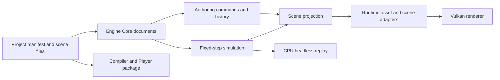

# Scene, simulation and rendering pipeline

Follow a scene from file validation to the viewport and standalone Player. Use this map to choose the layer
to change when adding a scene field, gameplay behavior or render feature.

## Read and validate content

The manifest names the entry scene and scene catalog, project asset paths and gameplay settings. Engine Core
loads and validates the documents. Persistent entity keys link parent relationships, component references and
authored settings. Runtime imports model and image assets for the viewport and Player. Register project-owned
assets before referencing them in a scene. See [project lifecycle](project-lifecycle.md) and
[graphics and assets](graphics-and-assets.md).

## Edit or simulate

Authoring commands change a retained draft under its current revision. Save All commits that draft to disk.
Play reads an authored scene into a simulation. Fixed-step updates consume project input actions and resolve
component behavior and movement. Keep input sampling and authored editing at their respective boundaries.
See [Editor command flow](editor-flow.md) and [timing and input](timing-input-camera.md).

## Present a frame

Runtime synchronizes the current scene projection, camera and asset handles for the renderer. Renderer allocates
and manages Vulkan resources and presents through the native surface. Scene mode can present editor tools and
an authoring camera. Game mode presents the active game camera and simulation. Check asset preparation,
projection freshness and surface state independently when a frame is missing. See [runtime](crates/runtime/README.md)
and [renderer](crates/renderer/README.md).

## Ship and verify

Export Game… prepares a saved project and packages the Player and referenced data. Reopen the exported folder from
a separate working directory to verify resource paths. Use headless replay to exercise the same CPU simulation
and a windowed run to check input, graphics and audio. See [Compiler](compiler/README.md) and [Testing](testing.md).
