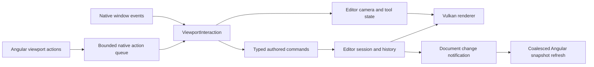
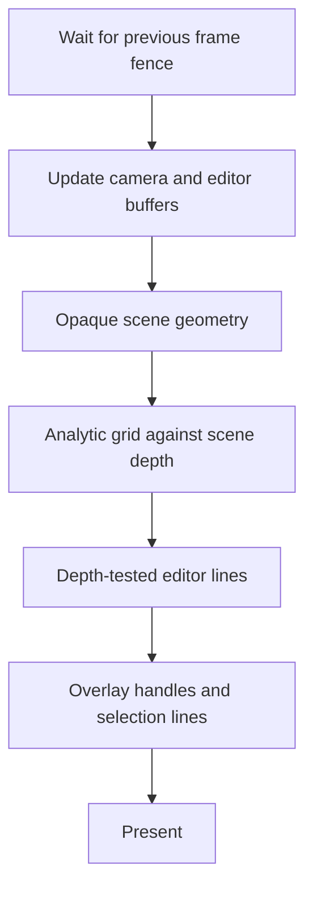

# Native scene editor implementation

The native Vulkan scene viewport provides an editor camera, construction grid, picking, transform handles and
placement from Assets. Angular supplies the surrounding controls. The native viewport handles spatial input and
renders camera movement independently of authored scene edits.

Use [Objects, components and Props](authoring-objects.md) to learn the accompanying Hierarchy, Inspector and
linked Prop workflows.

## 1. Start the editor

From the repository root:

```powershell
Set-Location 'D:\Coding\Game Engine'
.\dev.ps1 editor
```

The wrapper starts the Angular development server and Tauri host through the
existing launcher. Keep the owning terminal open during development.
The native host uses the editor server on port 4200.
Production frontend output is `apps/editor/dist/editor/browser`.

The embedded viewport currently requires Windows, WebView2, a compatible Vulkan
GPU/driver, and the existing renderer build prerequisites.
The shader build locates `glslc` through `VULKAN_SDK` or PATH.
A browser-only Angular session can exercise interface layout but cannot create
the native child window, issue native editor actions, or certify GPU behavior.

Open **File → Open Project…** and choose an authored `project.json`.
The bundled sample is `projects/cinder-oath/project.json`.
The chooser and replacement guard retain the current project after cancellation.
Replacing dirty state requires the reviewed discard decision and revision.

## 2. Create an authoring project

**File → New Project…** opens project setup with a Back to Editor action.
The menu respects opening, busy, Play, and transaction guards.
Enter a project name and an existing destination parent folder.
**Create project** creates a new child folder containing the starter manifest
and validated nested assets, then opens its manifest in the editor.

Creation does not compile or launch the standalone player.
That operation belongs to Export Game, described later in this guide.
The new project remains available if opening it is cancelled or fails.
The setup result exposes its path and **Open in Editor** for a retry without
creating the folder again.

The setup flow captures the current reviewed revision before an asynchronous
discard confirmation. It passes that revision and discard intent to the host.
Concurrent edits cannot be silently discarded under an older approval.
The native path validation and no-overwrite rules remain authoritative.

## 3. Understand the workspace

| Surface | Current responsibility |
| --- | --- |
| File menu | Guarded creation and opening of projects. |
| Frequent actions | Save Scene, Save All, history, entity actions, Play and Stop. |
| Scene controls | Active scene, startup selection, registration and Save As. |
| Scene/Game tabs | Choose the view shown by the single native surface. |
| Viewport toolstrip | Navigation, tool, basis, pivot, grid, snapping and projection controls. |
| Hierarchy | Browse parent/child entities, select stable keys and change parents. |
| Inspector | Edit the selected name and local transform numerically. |
| Assets | Browse scenes/models/prefabs, place models and copies, create/edit linked sources and link instances. |
| Export controls | Stage, compile, retry and explicitly run a standalone output. |

Hierarchy supplies expand/collapse, virtual rows and parent-changing actions.
It does not yet supply a visibility/layer tree or entity ordering. Prefab actions use Assets and the Inspector.
The existing generic Drawers retain resize/collapse preferences.
The scene list's maximum width is 45% of the available container.

## 4. Navigate without changing the game camera

The editor camera lives in `ViewportInteraction`, outside the scene document.
It stores an orbit pivot, yaw, pitch, distance, orthographic height, and clipping
parameters. Native input updates this value and requests a rendered frame.

Orbiting, panning, zooming, changing projection, and framing selection do not
change the authored game camera, scene dirty flag, or undo history.
The standalone player does not receive the editor camera or grid preferences.
The explicit authored camera APIs remain available for actual game-camera edits.

| Gesture/control | Effect in Scene view |
| --- | --- |
| Alt + left drag | Orbit around the editor pivot. |
| Middle drag | Pan in camera-right/camera-up directions. |
| Hand tool + left drag | Pan without a middle mouse button. |
| Right drag | Look around in fly navigation. |
| Right mouse held + W/A/S/D | Move forward/left/back/right. |
| Right mouse held + Q/E | Move vertically. |
| Shift during fly movement | Use the faster movement speed. |
| Mouse wheel | Dolly in perspective or zoom in orthographic. |
| + / − toolbar buttons | Apply the same multiplicative zoom model. |
| F / Frame Selection | Frame selected renderable bounds, or all available bounds when selection has none. |
| View selector | Free, top, bottom, front, back, left, or right view. |
| Projection selector | Perspective or orthographic. |

Tool shortcuts are owned by the native viewport while it has focus.
W/A/S/D/Q/E become movement keys during captured fly navigation rather than
switching transform tools. Inspector text and numeric inputs keep their normal
typing and editing keys because native input routing does not run in those fields.

## 5. Camera lifetime and projection

The first rendered scene is framed from its available renderable bounds.
Per-scene camera bookmarks are kept in the native interaction session.
Changing scenes in the same workspace restores a retained camera when present.
Project replacement resets the workspace generation and clears those bookmarks.
The bookmark collection holds at most 128 entries; it is not a persistent user
settings database.

The initial camera uses a Y-up, right-handed convention and a 60-degree vertical
field of view. Perspective and orthographic matrices use the renderer's Vulkan
clip-space convention. Ray unprojection and screen projection use that same matrix.
Extents must be nonzero and bounded before projection is evaluated.

Perspective zoom changes orbit distance multiplicatively.
Orthographic zoom changes vertical view height multiplicatively.
Both values have positive bounds, preventing accidental inversion at the pivot.
Pitch is clamped away from singular poles; orientation presets use stable axes.
View navigation remains f32-based at the current transform/rendering boundary.

## 6. Use the construction grid

The grid is a fullscreen analytic Vulkan pass, not thousands of authored lines
or scene entities. Its fragment shader reconstructs a ray through each pixel,
intersects the selected work plane, and evaluates periodic line coverage.
Fragment derivatives make the line edges stable at different viewing distances.

The toolstrip exposes Grid visibility, Plane, and Grid step.
The supported work planes are XZ, XY, and YZ through the origin.
Top/Bottom choose XZ, Front/Back choose XY, and Left/Right choose YZ.
Free view returns to perspective with the default scene orientation.

Visual spacing adapts from the configured base and projected units per pixel.
The current adaptation chooses a readable 1/2/5/10 subdivision scale.
Major lines occur every ten displayed cells.
Distance and grazing-angle fades reduce horizon noise.
Colored axes identify the plane directions without adding authored geometry.

**Grid step and Move snapping are separate settings.**
Zooming can change displayed line density while the requested snap increment stays
fixed. A one-unit move increment remains one unit even when the visible grid
switches to a coarser subdivision.

One unit is not an enforced physical metre in the file format.
Import scale and the game's own world convention still determine physical meaning.
The proposed one-unit/one-metre starter convention does not rescale existing assets.

## 7. Select entities

Click a rendered object in the native viewport to select its stable entity key.
The selection is shared with Hierarchy and Inspector through the Rust session.
Clicking a Hierarchy row selects the same key through the existing command path.

Shift adds hits to the existing selection.
Ctrl, or the platform command modifier, toggles individual hits.
An unmodified empty click clears selection.
Selection changes refresh authored UI state without changing transforms.

Drag a selection rectangle on empty space for marquee selection.
Dragging to the right requires projected bounds to fit inside the rectangle.
Dragging to the left accepts bounds that intersect it.
The selection limit remains the backend's 4,096 keys.

Picking currently uses transformed model bounds, not triangle intersections or a
GPU object-ID buffer. Hollow, concave, overlapping, or heavily rotated geometry
can therefore select a bounding box in an area without a visible triangle.
Non-renderable entities and singular world transforms are omitted from these
native pick targets. Such entities remain accessible through Hierarchy.

Selected objects are marked with bounding-box line decoration.
This is a deliberate bounds outline, not a silhouette/stencil outline.
Very large selections use a grouped bounds representation to keep overlay work bounded.

### Work with the hierarchy

Expand a parent's disclosure to show its children; disclosure changes do not
select the entity. Selecting an entity from the viewport reveals its ancestors.
Up/Down/Home/End navigate rows; Right expands or enters a child, and Left collapses
or reaches its parent. Typeahead finds names; Enter/Space confirms the active row.

Drag a row onto another row to set its parent, or onto Scene root to unparent it.
Set Parent and Move to Root provide keyboard-accessible alternatives.
In Set Parent mode, select/confirm the destination or press Escape to cancel.
Self-parenting, descendants and unchanged parents are rejected locally; Rust
performs authoritative validation and can reject an unrepresentable world pose.
Reparent uses keep_world=true after committing the active Inspector draft.
The UI waits for accepted state rather than optimistically rewriting the tree.

Rows use a 28-pixel virtual window with six-row overscan and a retained active
descendant. Iterative traversal avoids recursion limits in deep trees.
Visual indentation is capped at eight levels while aria-level retains full depth.
Only this Hierarchy's internal entity drag is accepted; model/external drags are
separate workflows. Tree construction still depends on authored entity count.

## 8. Move, rotate, and scale with handles

| Tool | Shortcut | Handles |
| --- | --- | --- |
| Hand | Q | Navigation only. |
| Move | W | Axis arrows, plane regions, and a screen-plane center. |
| Rotate | E | Rings around the three handle axes. |
| Scale | R | Axis scale handles and uniform center scaling. |

Handle size is derived from the camera's projected units per pixel.
It remains usable when zoom changes rather than becoming tiny in the distance.
Hit tolerances are expressed in physical pixels after the current DPI conversion.
The visible line width is independent of Vulkan's optional wide-line feature.

World uses world-aligned handle axes.
Local derives its basis from the active selected object's world orientation.
Pivot uses the active object's pivot.
Center uses selected available bounds, with a pivot fallback when no bounds exist.
The active object follows the session's selection order.

When a selected parent and its child are both selected, the transform operation
targets the selected roots. It avoids applying the same group movement twice
through both a parent matrix and a child matrix.

Move captures local transforms and parent inverses, then converts the world-space
translation back into each selected root's parent space.
This preserves existing local rotation and scale, including cases whose composed
world matrix contains shear.
A zero-scale/singular parent cannot be inverted; the operation reports an error.

Rotate and Scale construct a world-space group operation around the chosen pivot.
The current scene format stores translation, Euler rotation, and scale rather
than arbitrary affine matrices. A result requiring unrepresentable shear is
rejected and cancelled instead of silently changing the object's pose.

Interactive scale factors stay positive with a small minimum to avoid crossing
through a singular transform during a drag. Numeric Inspector values retain the
existing backend validation semantics, including authored negative scale.

## 9. Snap a gesture

Snap enables the native tool's configured increments.
The Navigation & Snap panel exposes Move, Rotate in degrees, and Scale increments.
Each value must be finite and positive before reaching tool calculations.
The initial increments are 1 unit for Move, 15 degrees for Rotate, and 0.1 for
Scale. Snapping starts disabled; the visible grid starts enabled with base step 1.

Holding Ctrl when beginning a transform also enables snapping for that gesture.
The gesture captures its starting settings rather than reading changing UI values
halfway through an axis operation.
Rotation increments cross the degrees/radians boundary explicitly.
The Inspector continues to show degrees while the scene contract uses radians.

The current grid setting does not promise vertex snapping, magnetic sockets,
surface-normal alignment, or arbitrary construction-plane offsets.
Those require additional typed placement/tool contracts.

## 10. Commit and cancel one gesture

A native handle press captures the tool, projection, extent, baseline transforms,
and starting pointer position. The controller opens one grouped Rust transaction.
Replaceable pointer motion is coalesced by the native worker before preview.
The latest pointer value is flushed before release is processed.

Preview mutations use the existing typed transform commands and validation.
Releasing the initiating button commits one transaction and one undoable result.
Escape cancels it and restores the captured authored state.
Changing tool/projection or losing native focus resolves the active gesture safely.
Resize/DPI changes invalidate the captured projection and cancel the gesture.

Undo and Redo use the same history as numeric Inspector edits.
Ctrl+Z, Ctrl+Shift+Z, Ctrl+Y, Duplicate, and Delete are available through their
native shortcut/control paths when authoring is permitted.
An unavailable operation reports an error rather than bypassing an open transaction.

## 11. Edit exact values in Inspector

Inspector displays the selected entity's name, model reference, and local
Position, Rotation, and Scale.
The shared Vector3Field supplies labeled X/Y/Z inputs with field-level gesture
start, live change, commit, and cancellation events.

SceneEditingService owns field drafts and a bounded latest-value preview pattern.
Each continuous field edit is grouped into one history action.
Blur or Enter commits; Escape restores its starting value.
Incomplete numeric input stays a UI draft rather than becoming NaN in the scene.
Invalid names and f32 overflow never become accepted authoring commands.

Before selection, Save, Play, or another reserved workspace action, the current
field edit is settled through the commit barrier.
Native transform, placement, and asset-loading states lock competing authoring.
Camera navigation alone does not acquire that authoring lock.
The Inspector is read-only during Play.

### Collider shape, sensor and filters

The Collider section adds None/Box/Sphere, local offset, half extents/radius, Blocking/Sensor mode and 32 layer/mask
bits. Numeric previews share the transaction rules above; invalid final input cancels the gesture. Discrete shape,
mode and bit changes are atomic edits that preserve the latest accepted dimensions and other interaction settings.
The **Colliders** toolstrip toggle displays selected effective shapes in Scene: continuous cyan for blocking and
dashed pink for sensors. It is view state, does not dirty the scene, and is hidden in Game.

Box collision follows a transformed world AABB; sphere scale conservatively encloses hierarchy shear. Sensor pairs
can overlap but do not block movement, and both layer/mask directions must match. Outline work is cached/bounded;
omissions or invalid world geometry produce a nonfatal collider diagnostic. See [collider semantics and limits](scene-editing.md#colliders-and-interaction-settings).
Sensor overlaps feed fixed-step Enter/Stay/Exit delivery and native component behaviors; the overlay remains view-only.

## 12. Place a catalogued model

1. Open the Assets drawer.
2. Use Load Models or Refresh Models to obtain the current model catalogue.
3. Open its folder and press on a glTF/GLB model entry.
4. Drag beyond the small movement threshold to start placement.
5. Move over Scene and inspect the native placement marker.
6. Release at a valid surface or construction-plane point.
7. Wait for loading/adoption to complete before editing the new entities.

The native marker is currently a lightweight bounds box at the proposed position.
It does not load and draw the final model as a detailed translucent ghost.
Surface hits use available model bounds.
A miss falls back to the selected origin work plane when the ray intersects it.
Parallel/invalid rays produce no valid placement point.

Move snapping affects coordinates tangent to the hit surface/plane while
preserving its constrained surface coordinate.
The implementation does not yet align a model's bottom bounds or normal to a
surface. The imported model's origin remains the placement reference.

Dropping outside the viewport cancels placement.
Escape, capture loss, WebView blur during an unfinished pointer drag, or a native
cancellation action can end the pending placement without creating entities.
The existing Add to Scene action remains the keyboard-friendly origin-placement
alternative for a selected model.

## 13. Why asset dragging uses pointer capture

The WebView and Vulkan viewport are separate Windows surfaces.
Ordinary HTML dragover/drop handlers cannot be assumed to receive events over a
native child window. The internal asset broker therefore captures the pointer
on the original Assets button and coordinates the native preview explicitly.

The broker measures the actual viewport aperture in CSS client coordinates.
It sends normalized coordinates in [0, 1] rather than multiplying them by device
pixel ratio. The native worker maps those coordinates into its prepared physical
extent. This avoids applying the DPI conversion twice.

The broker stores only the latest replaceable placement point behind an action
already in flight. Begin, final point, Commit, and Cancel preserve their order.
On release, the final normalized position is flushed before the drop boundary.
The captured pointer is released after the drag resolves.

Dragging is available only for model entries belonging to the active catalogue.
The native side still validates relative paths and containment in project Assets.
This is an internal model-placement operation, not external OS file import.

## 14. Loading and adoption are separate

CommitPlacement submits an asset job and returns an asset-loading state.
It does not promise that the model is already authored at the moment IPC returns.
The UI displays Loading and placing model until native completion.
Its generic Model placement finished message does not distinguish adoption from
native cancellation; accepted Hierarchy/document changes establish creation.

The job captures the workspace generation and expected document revision.
The viewport submission reserves a 128 MiB asset-job budget through the existing
workspace broker; queue/budget rejection remains an ordinary placement error.
Adoption checks those identities and edit/transaction state again.
A stale, cancelled, failed, or over-budget result does not create an instance.
Successful adoption selects the imported entities through the normal editor path
and notifies Angular that the authoritative document changed.

Camera navigation can continue while loading.
Competing authored edits are locked while the placement owns its asset job.
Cancellation asks the job service to stop or reject adoption.
Native completion clears the placement state and reports its error when necessary.
The resulting model creation uses the shared undo/history semantics.
The controller reconciles its ticket against retained workspace completions after
draining, so another notifier/IPC consumer draining first cannot leave loading stuck.

## 15. Scene and Game share one surface

The workspace retains one SceneViewport and one native renderer.
Selecting Game does not create a second simulation.
Play starts the existing runtime session and selects Game.
Stop restores Scene and the authored data.

Scene remains available during Play for editor-camera inspection.
Its authoring tools and Inspector remain read-only.
Game uses the runtime/authored game camera and suppresses editor grid/handle
decoration. Selecting Game while stopped shows a stopped-preview explanation.

Native gameplay input is separate from editor tool shortcuts.
Gameplay focus, movement routing, release, and focus-loss cleanup belong to the
native interaction owner; Angular does not replay raw movement into scene commands.
Click Game to focus its input, then use W/A/S/D with the shared movement bindings.
Releasing a key updates movement; Escape or focus loss clears held play input.
Scene view preferences and camera bookmarks remain separate from runtime movement.

For Cinder Oath, open `projects/cinder-oath/project.json` and choose `scenes/oath.json` in
**Game → Scene Information…**. Click **Play** and focus Game. Watch the introduction or press **Enter** to reach the
vault. Use **W**, **A**, **S** and **D** to move and **F** to attack. The runtime status follows the active Play scene,
while the Scene view retains the authored draft.

Use **Restart Run** to load the configured startup scene with fresh progress and **Stop** to return to authoring.
[Gameplay module selection](project-lifecycle.md#gameplay-module-selection).

## 16. Save scenes and project settings

Save Scene persists the active authored scene only.
Save All preflights scene paths and documents, then persists every dirty retained
scene and the dirty/missing project manifest without switching the active scene.
Successful writes advance their corresponding saved baselines immediately.
A later failure retains accurate dirty state for the remaining work.

The Scene selector switches retained scene drafts.
Use as Startup changes the project startup scene and requires saving the manifest.
Register Existing Scene adds a valid existing relative scene path to the catalogue.
Save Scene As writes a new file and changes the active scene's registered path;
it preserves existing files and requires a new destination.

Scene file actions use paths relative to Assets, such as `scenes/level.json`.
The **Gameplay Roles** dropdowns assign or clear bindings on the active scene.
Undo and Redo restore role changes through the scene history. Scene saves persist
the bindings. [Role requirements](project-lifecycle.md#gameplay-role-bindings).
Save All persists catalogue/settings changes after these operations.
Undo history and dirty-state behavior remain the core editor's responsibility.

## 17. Export and run the saved game

Save All and stop Play before using Export Game.
Choose an existing output parent folder separate from the authoring project.
The output child uses the project name and is not merged into an existing folder.

The export has two explicit stages:

1. Prepare every saved document and its models, validate selected gameplay for
   each scene, and stage verified assets and manifest into the new output folder
   before returning a build token.
2. Finish: compile the release player and install it into that staged output.

The editor commit reservation lasts through preparation acknowledgement.
Once inputs are staged, compilation does not occupy the document command queue.
The author can continue editing and saving the source project while compilation
uses its already staged inputs.

Failed compilation retains a retryable token unless a newer prepared build has
superseded it. Retry Export uses that same staged output rather than attempting
to overwrite a newly existing folder.
Failed/incomplete output is retained for inspection.

The result shows its output path, asset count, and byte total.
Run Exported Game is an explicit separate action.
The host validates the expected remembered successful path and starts its player
with that output as the working directory and player mode selected.
Successful process creation is not proof of Vulkan initialization or rendering.

## 18. Runtime ownership and input flow



ViewportHost owns native lifecycle state and the worker boundary.
ViewportInteraction owns input state, editor camera, selection gestures, tool
transactions, and placement lifecycle.
EditorCamera/Gizmo/GizmoDrag supply window-independent spatial math.
The core editor retains authored mutations and validation.

GPU resource creation, uploads, waits, acquisition and presentation occur outside
the workspace mutex. CPU scene synchronization may acquire that mutex briefly.
No camera movement requires Angular to accept a new full scene document.

## 19. Editor-only bridge contract

Rust contracts live in `crates/bridge/src/viewport.rs`.
Their TypeScript mirror is `core/editor/viewport-editor.models.ts`.
They are separate from scene schema 4 and editor document protocol 2.
These view/tool settings are not additional fields in project or scene JSON.

| Native command | Input | Result |
| --- | --- | --- |
| editor_viewport_editor_state | No arguments. | Current editor camera/tool summary. |
| editor_viewport_action | A typed action. | Applied state or a rejected action. |
| editor_viewport_attach | CSS logical aperture bounds. | Native lifecycle/status summary. |
| editor_viewport_bounds | Updated aperture bounds. | Native lifecycle/status summary. |
| editor_viewport_detach | No arguments. | Detached lifecycle/status summary. |

View actions include SetTool, SetSpace, SetPivot, SetGrid, SetGridSpacing,
SetSnap, SetSnapIncrements, SetProjection, SetPlane, SetView, Orient, Zoom,
SetColliders, FrameSelection, ResetView, Cancel, and the placement lifecycle actions.
The wire uses tagged snake_case names, such as `set_tool` and `begin_placement`.
Host commands retain trusted-main-window checks and validate action values.

The state contains settings, camera position/target/distance, view revision,
workspace generation, current gesture/placement, focus, and an optional error.
During a native transform, an optional transform_preview carries the primary
selected entity's key and current local transform for the Inspector.
It is a presentation summary, not an authored scene snapshot.

`settings.colliders` defaults false for older serialized view state, and optional `collider_error` defaults absent.
The separate collider diagnostic does not replace the main viewport error or stop scene presentation.

## 20. Notifications and bounded queues

`editor://viewport-editor-state` updates the view/tool summary.
Continuous camera and compact transform previews publish at most 20 times per
second; semantic boundaries publish promptly.
They never trigger authored-document refresh merely because the camera moved.
An unpublished final state schedules a 50 ms event-loop deadline, so completion
cannot remain hidden merely because the viewport becomes idle afterward.

Native transform previews still update the authoritative in-memory transaction
and renderer on the interaction path. The compact state preview lets the
Inspector display the active local transform without replacing EditorService's
whole scene snapshot on every mouse movement.

`editor://viewport-document-changed` carries workspace generation and revision.
ViewportEditorService coalesces bursts and refreshes authoritative in-memory
state through EditorService. It does not reload files from disk.
Stale view-state revisions/generations are ignored.
Native transform begin, commit and cancellation publish document boundaries;
intermediate transform movement uses the compact state preview instead.

The frontend view-action queue is capped at 32 pending requests.
The native action queue is capped at 64. A queued request expires after 8 seconds;
the command waits up to 9 seconds for the worker's applied-state reply.
Both frontend and native queues bind requests to their originating workspace.
The native worker rechecks generation and expiry after acquiring the mutation lock.
Frontend-local context counters and native generations are distinct namespaces;
the service binds them without comparing their numeric values for equality.
On replacement it clears old gesture/preview state and rejects retired callbacks.
Placement motion has one latest replaceable point behind work in flight.
Native mouse motion is coalesced before interactive previews.
Press, final motion, release, commit and cancellation retain semantic order.

The document command queue remains separate and revision-aware.
Continuous authored edits still use the existing core mutation machinery;
this implementation does not claim that every scene mutation is O(1).

## 21. Cache and rendering lifetime

Pick targets are cached by workspace generation and scene revision.
Camera-only navigation reuses them.
Selected-root transform data is cached by document identity/revision and
selection keys so camera frames avoid rebuilding full hierarchy matrices.
Active drags retain their captured handle/basis and Move delta for decoration,
avoiding another complete world-matrix rebuild merely to draw the moving gizmo.
Game view skips rebuilding Scene picking bounds; returning to Scene refreshes
the cache against the latest render document.
The renderer retains overlay vertex capacity and grows it within the 16,384-line
editor visual limit.

Idle Edit waits for invalidation rather than rendering a static grid forever.
Active simulation, fly movement, interaction, or presentation recovery can request
frames. Hidden/minimized/inactive surfaces suspend the relevant work and clear input.
Frame scheduling distinguishes navigation from authored simulation.
Fly movement uses elapsed time and schedules camera ticks only for a nonzero
movement vector, so a held modifier or opposing keys do not render idle frames.

Editor visual data is passed as EditorVisuals with an optional grid and colored
line segments. It never becomes an authored entity, material, or packaged asset.
WindowRenderer creates editor pipelines lazily when these visuals are present.
Their attachment-format lifetime follows the renderer's swapchain/depth policy.

## 22. Grid and overlay rendering order



The grid depth-tests against geometry and does not write depth.
It reconstructs the plane depth using the same Vulkan projection convention.
Minor/major line coverage is evaluated before fragment-varying rejection.
Finite checks and horizon fades avoid unstable long-distance fragments.

EditorLine is expanded into clipped screen-space quads for stable pixel width.
This avoids requiring the optional hardware wide-line feature.
Depth-tested and overlay segments are submitted as separate batches.
Selection/handle lines use overlay behavior so spatial controls remain visible.

Host-visible overlay writes occur after the previous frame fence.
Capacity growth is bounded by the editor line limit and retains the previous
capacity correctly if allocation fails.
GPU objects remain owned by the worker/renderer and retire before device teardown.

## 23. DPI, capture, focus and native airspace

Angular aperture bounds are CSS logical client pixels.
Native input positions and prepared render extents are physical pixels.
The host applies monitor scale at the surface boundary, and normalized asset
placement avoids an additional frontend device-pixel-ratio multiplication.

Native mouse capture confines the cursor while a gesture owns the viewport.
The initiating button and cancellation boundaries determine when ownership ends.
Focus loss clears navigation keys and cancels authored transform state.
WebView blur cancels an unfinished pointer drag. After drop submission, ordinary
WebView-to-native focus transfer retains the asynchronous import; Escape or the
visible cancellation control still cancels loading. Native visibility/teardown
boundaries retain their own cleanup rules.

Ordinary HTML cannot be relied on to float above the native child HWND.
The toolstrip stays outside its aperture; spatial grid/handles/markers are Vulkan.
WebView modal dialogs suppress the native child through the existing wrapper.
Native file dialogs remain parented host dialogs.
Multi-monitor DPI, external capture loss, and driver/device failure require desktop
acceptance beyond DOM and math tests.

## 24. Source map

| Source | Responsibility |
| --- | --- |
| crates/bridge/src/viewport.rs | View-only DTOs, defaults and action validation. |
| apps/editor-host/src-tauri/src/viewport.rs | Child lifecycle, worker, action mailbox, render scheduling and native events. |
| apps/editor-host/src-tauri/src/viewport_interaction.rs | Tool state, selection, transactions, bookmarks, import ownership and caches. |
| apps/editor-host/src-tauri/src/viewport_tools.rs | Projection, rays, bounds picking, grid spacing, handles and drag math. |
| apps/editor-host/src-tauri/src/commands/editor.rs | Trusted viewport command entry points and asynchronous replies. |
| crates/renderer/src/editor_visuals.rs | Editor grid/line contracts and clipped line expansion. |
| crates/renderer/src/vulkan/editor.rs | Grid/line pipelines, bounded GPU buffer ownership and recording. |
| crates/renderer/shaders/editor-grid.vert / editor-grid.frag | Analytic work-plane grid shader. |
| crates/renderer/shaders/editor-lines.vert / editor-lines.frag | Colored editor line shaders. |
| apps/editor/src/app/core/editor/viewport-editor.service.ts | Typed view action queue, state listeners and document refresh coalescing. |
| apps/editor/src/app/modules/editor/workspace/viewport-asset-drag.service.ts | WebView pointer capture and placement broker. |
| apps/editor/src/app/modules/editor/workspace/viewport-toolbar/ | Adjacent accessible view/tool controls. |
| apps/editor/src/app/modules/editor/workspace/scene-viewport/ | Aperture registration, native lifecycle wrapper and modal suppression. |
| apps/editor/src/app/modules/editor/workspace/scene-editing.service.ts | Inspector drafts, commit barriers and recoverable field edits. |
| compiler/src/lib.rs | Authoring creation, immutable staging and standalone export. |

## 25. Checks and evidence

Run focused checks from the repository root:

```powershell
cargo test -p app --lib viewport_tools --offline --locked
cargo test -p app --lib viewport_interaction --offline --locked
cargo test -p app --lib viewport::windows:: --offline --locked
cargo test -p renderer --lib editor --offline --locked
cargo test -p bridge --offline --locked
```

Run frontend checks from `apps/editor`:

```powershell
npm.cmd run check:production
npm.cmd test -- --watch=false
```

Use these tests to check camera projection, pointer capture, transactional transforms, queue limits and lifecycle
behavior. Use the desktop walkthrough to check Windows input delivery, focus and visible rendering.

## 26. Desktop acceptance walkthrough

1. Open the bundled project with the desktop editor.
2. Confirm a visible grid and scene geometry.
3. Orbit, pan, zoom, and switch projection/orientation.
4. Confirm the authored camera, dirty state and history are unchanged.
5. Pick an entity and confirm Inspector/Hierarchy agree; test keep-world parenting.
6. Move with one axis, cancel, and confirm the starting transform returns.
7. Move again, commit, Undo once, and Redo once.
8. Try Local/World, Pivot/Center, plane movement, Rotate and Scale.
9. Change DPI/resize during a gesture and confirm safe cancellation.
10. Drag a model from Assets, cancel it, and confirm no new entity exists.
11. Drop a model at a valid point and wait for adoption.
12. Confirm one undoable creation and a clean end to asset-loading state.
13. Play Cinder Oath and confirm the transition to the vault, sword input and victory condition.
14. Restart Run, then Stop and confirm authored transforms, roles and Scene viewpoint.
15. Save All, close/reopen, export, and repeat the route with the player outside the repository.

Record hardware, DPI, project fixture, observed result and any failure for those
steps. A successful process spawn or an empty viewport is not sufficient evidence
for the complete native authoring workflow.

## 27. Remaining feature boundaries

- Native picking and placement use bounds approximations.
- Selection decoration is a bounds box rather than a geometry silhouette.
- The placement ghost is a lightweight marker rather than the final loaded mesh.
- Hierarchy does not yet provide visibility/layers or manual ordering; prefab authoring uses Assets and the Inspector.
- View preferences/bookmarks are session state, not persisted per-user viewport files.
- Rotate/Scale can reject affine results the scene's TRS format cannot represent.
- Snap settings do not provide vertex/socket snapping or arbitrary surface alignment.
- Animation/shader graph workspace types are not finished authoring editors.
- End-to-end native, supported-machine, and measured performance acceptance remains explicit.

These boundaries keep the next work concrete: resolve observed authoring friction
in a small playable project, then extend the relevant tool or contract.
[Objects, components and Props](authoring-objects.md) gives a workflow you can reproduce in a project.
